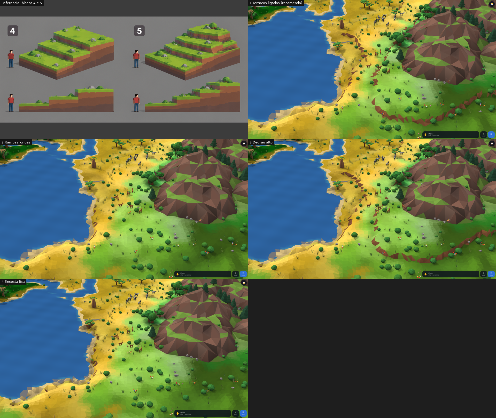
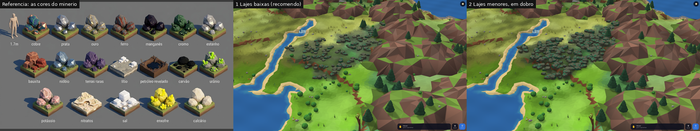
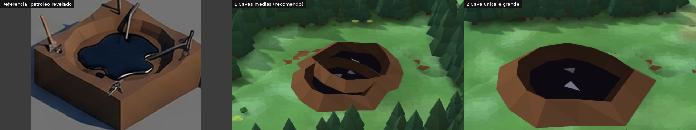
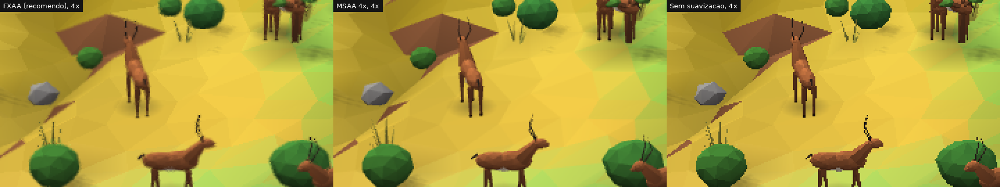
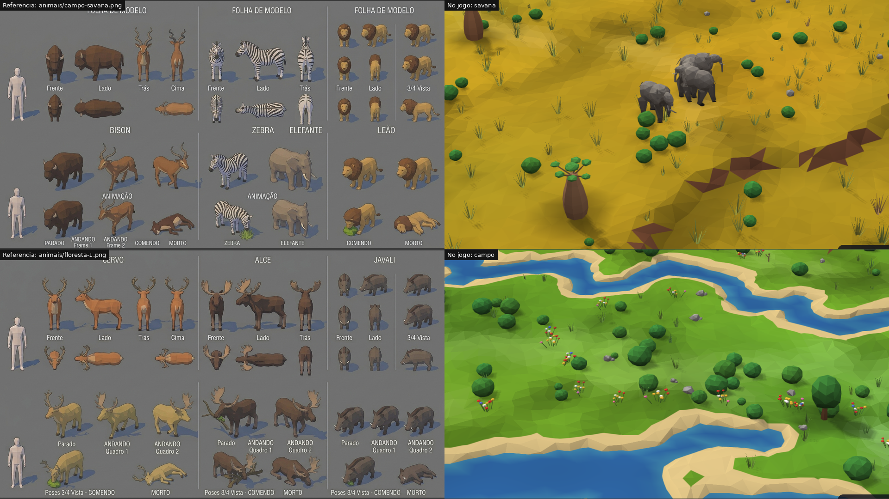

# Decisões visuais da maquete

Capturas no **Firefox 158, em janela de 1920×1080**, reduzidas na folha, ao lado das referências. Mesmo mundo (semente `terra`) e mesmo lugar em cada comparação. Para ver no jogo, acrescente à URL da prévia: `&relevo=`, `&pedras=`, `&oleo=`, `&aa=`.

GPU medida no Chromium com o relógio da GPU, numa rodada só, antes destes últimos ajustes; diferenças de menos de 0,5 ms ficam dentro da variação. O seu relatório no Firefox decide.

## 1. Relevo

| Opção | Encosta entre patamares | GPU |
|---|---|---:|
| **1 Terraços ligados (recomendo, no jogo)** `terraco` | Curta, com terra à mostra | 6,4 ms |
| 2 Rampas longas `rampa` | Larga, sem terra | 6,6 ms |
| 3 Degrau alto `degrau` | Quase parede, com terra | 7,0 ms |
| 4 Encosta lisa `lisa` | Sem patamar | 6,9 ms |

**Recomendo a 1:** é a mais próxima dos blocos 4 e 5. Ninguém anda ainda de verdade neles: isso só será testado com os humanos (M4).

## 2. Jazidas: afloramento de rocha manchada

| Opção | O que é |
|---|---|
| **1 Lajes baixas (recomendo, no jogo)** | Uma laje por célula, com a mancha do minério no chão |
| 2 Lajes menores, em dobro `pedras=miudas` | Duas por célula, menores, mais espalhadas |

**Recomendo a 1:** lê como rocha aflorando, sem virar monte. **A referência serve só para a cor:** a sua decisão trocou os montes da folha pelo afloramento, e não há folha desenhada dele.

## 3. Petróleo aparente

| Opção | O que é |
|---|---|
| **1 Cavas médias (recomendo, no jogo)** | Cerca de 1 cava a cada 5 células da mancha aparente |
| 2 Cava única e grande `oleo=unica` | 1 cava a cada 10 células, maior |

**Recomendo a 1:** uma cava sozinha fica fácil de achar, e várias perto contam que ali há um campo. Em ambas, as árvores abrem espaço em volta.

## 4. Suavização
Recorte aumentado 4×; em tamanho normal a diferença é bem menor.

| Opção | GPU, entrada | GPU, de perto | Efeito |
|---|---:|---:|---|
| **FXAA (recomendo, no jogo)** | 6,4 ms | 5,6 ms | Bordas lisas, faces um pouco mais macias |
| MSAA 4× `aa=msaa4` | **12,0 ms** | **9,1 ms** | Bordas mais nítidas; **estoura a meta de 8 ms** |
| Sem suavização `aa=off` | 5,2 ms | 4,5 ms | Serrilhado visível |

## 5. Animais

Corpos mais cheios, em grupos por espécie, andando e comendo com movimento contínuo. **Ainda diferem das folhas:** silhueta mais simples, com listras e pintas por faceta. Sua decisão aqui é: **está bom para seguir, ou quer outra rodada de forma antes da ecologia.** Recomendo seguir e voltar à forma no acabamento (M8), porque a ecologia muda só o comportamento.
