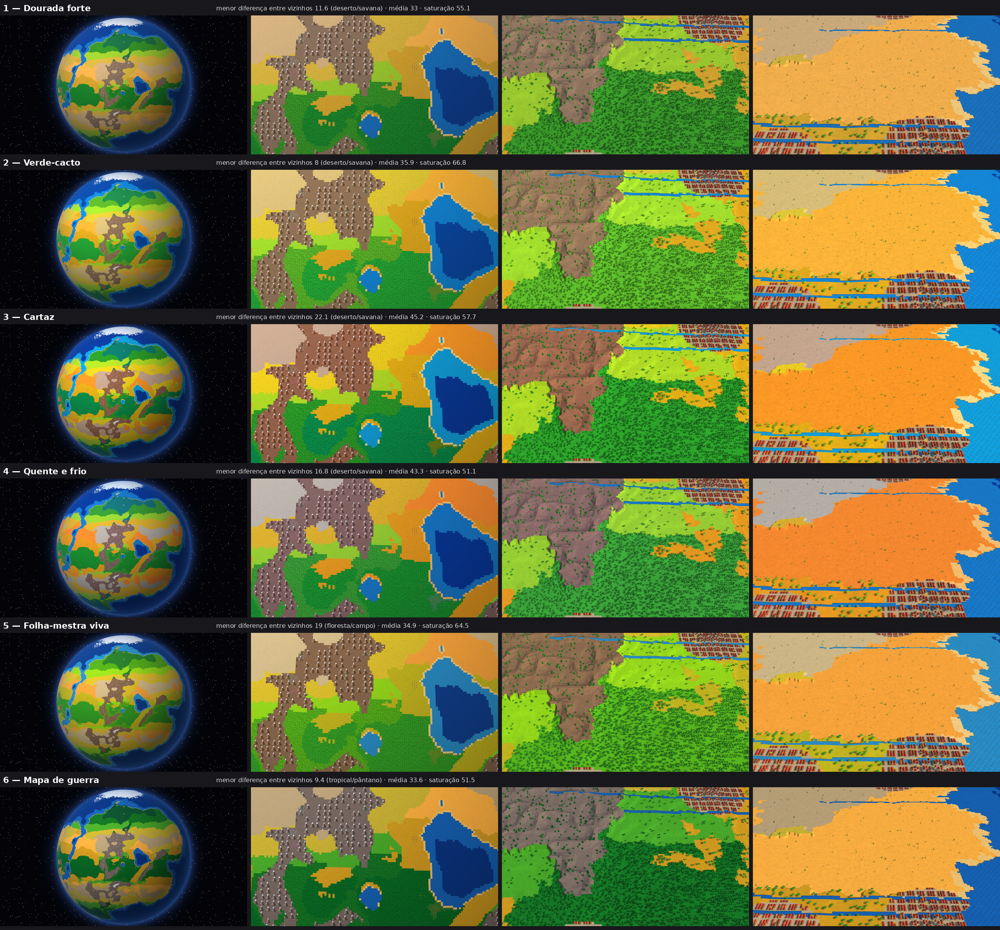
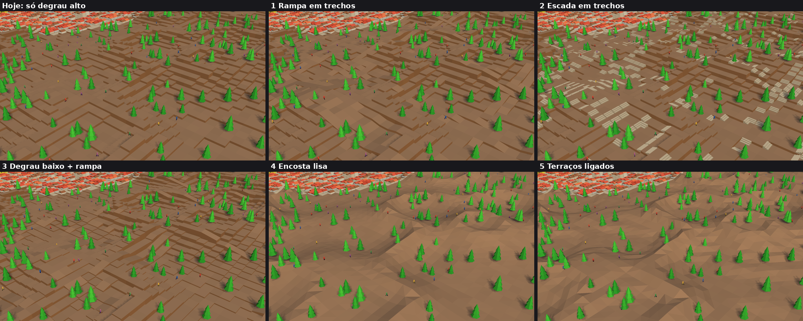
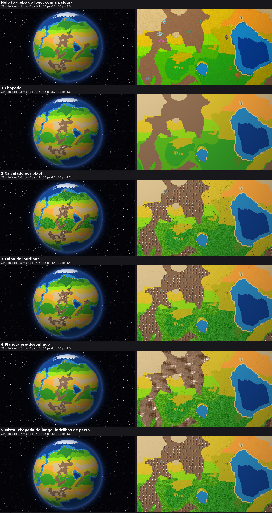
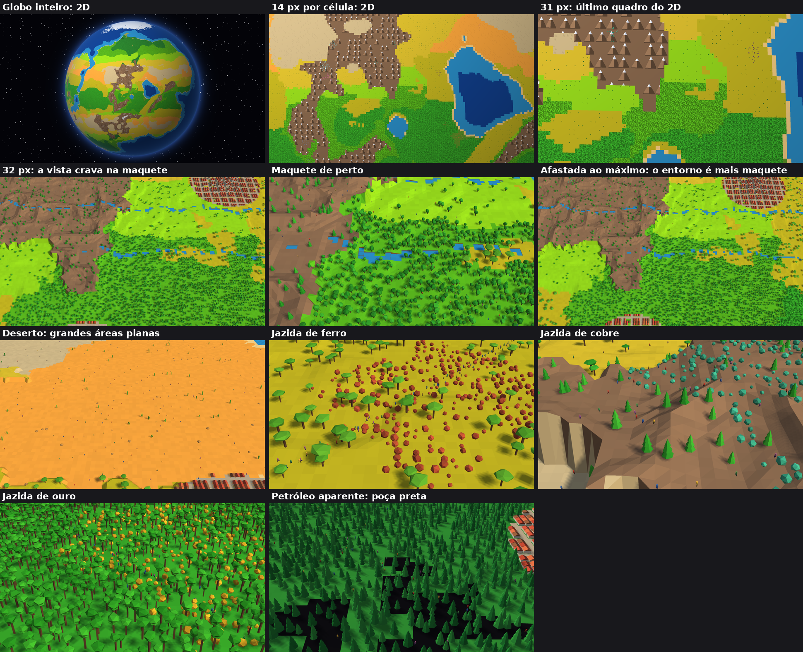

# Portão do M3: decisões visuais (paleta, passagem entre níveis, aplicação do 2D)

Tudo aqui está só no protótipo, e o jogo não mudou. Veja ao vivo em **https://berzeruska.github.io/sandbox-mundo/previa/atual/prototipo/**, mudando a URL (depois do `?`): `paleta=0` a `5`, `relevo=degrau|rampa|escada|baixo|lisa|terraco`, `longe=jogo|chapado|procedural|atlas|prerender|misto`. Exemplo: `?paleta=4&relevo=terraco&longe=atlas`.

Medido no Chromium sem janela, GPU real do notebook, 1080p, na tomada. **Sua medição no Chrome é quem decide.** A cor e a luz vêm da folha-mestra e da sua decisão 1.3; as outras referências dão a forma.

## 1. Paleta (item 1.3)
Cores da Hora dourada, luz de meio-dia da Maquete viva. Nas colunas: globo inteiro, 2D de perto, maquete e deserto.

"Diferença entre vizinhos" é a distância de cor entre biomas que costumam se encostar: quanto maior, mais fácil de separar. Saturação é a média dos biomas de terra. A paleta não muda o custo de GPU.

| Opção | Menor diferença entre vizinhos | Saturação | Como fica |
|---|---:|---:|---|
| 1 Dourada forte | 11,6 (deserto/savana) | 55 | A mais fiel à D; deserto e savana quase se confundem |
| 2 Verde-cacto | 8,0 (deserto/savana) | 67 | A mais viva; deserto e savana se confundem |
| 3 Cartaz | 22,1 (deserto/savana) | 58 | A mais separada; taiga azulada, menos natural |
| 4 Quente e frio | 16,8 (deserto/savana) | 51 | Clima muito legível; a menos saturada |
| **5 Folha-mestra viva (recomendo)** | 19,0 (floresta/campo) | 65 | Saída das suas folhas: segunda mais viva e segunda mais separada |
| 6 Mapa de guerra | 9,4 (tropical/pântano) | 52 | Matas escuras como a C; tropical e pântano se confundem |

## 2. Passagem entre níveis (item 1.8)
Mesmo lugar, encosta perto de uma cidade. "Alcance a pé" é quanta terra à vista um boneco alcança a partir da maior região contínua. Quem anda fica sempre em cima da superfície, sem desnível.

| Opção | Alcance a pé (lugar acidentado) | GPU | Pedaços na GPU | O que muda |
|---|---:|---:|---:|---|
| Hoje: só degrau alto | 5% | 6,0 ms | 21 MB | Bonecos presos em ilhas: é o problema relatado |
| 1 Rampa em trechos | 33% | 5,9 ms | 21 MB | Degraus visíveis e rampas; encosta com degraus de 2 alturas ainda trava |
| 2 Escada em trechos | 33% | 7,0 ms | 44 MB | Bonito perto de cidade; visualmente carregado em todo o relevo; a mais cara |
| 3 Degrau baixo e rampa | 33% | 5,9 ms | 24 MB | Degraus miúdos onde é suave; igual à 1 no lugar acidentado |
| 4 Encosta lisa | 100% | 5,6 ms | 16 MB | Tudo se anda, a mais leve; relevo sem degrau nenhum, parecido com morros |
| **5 Terraços ligados (recomendo)** | 100% | 5,7 ms | 16 MB | Patamares planos ligados por encosta curta, como os blocos 4 e 5 de `degraus-e-rampas.png` |

Recomendo a 5: é a única que mantém degraus à vista sem ninguém ficar preso, e sobra espaço para as escadas e os terraços das cidades (M4/M8). Limite: o alcance não considera água nem penhasco de borda, e os bonecos ainda andam ao acaso, sem procurar caminho.

**Desertos** já com grandes áreas planas em todas as opções (imagem na seção 4). Humanos aplainando o terreno: M4, só registrado.

## 3. Como aplicar o 2D de longe (item 1.7)
Referência C. Tudo sobre o globo que já existe: o protótipo só acrescenta um trecho ao desenho dele, e nada do jogo foi refeito.

| Opção | GPU: inteiro · 8 px · 16 px · 30 px por célula | Custo extra | O que muda |
|---|---|---|---|
| Hoje (globo do jogo) | 4,3 · 6,1 · 6,0 · 5,8 ms | | Não é o estilo C |
| 1 Chapado | 3,3 · 3,6 · 3,7 · 3,6 ms | Nenhum | O mais leve; sem floresta, árvores nem montanhas: é a A da imagem, não a C |
| 2 Calculado por pixel | 3,8 · 4,9 · 4,8 · 4,7 ms | Nenhum | Estilo C; mudar um desenho exige mexer no código de desenho |
| **3 Folha de ladrilhos (recomendo)** | 3,5 · 4,5 · 4,5 · 4,4 ms | Imagem pequena (64×256) | Estilo C; floresta, árvores e areia saem de uma folha fácil de redesenhar; montanhas calculadas |
| 4 Planeta pré-desenhado | 4,2 · 4,4 · 4,4 · 4,0 ms | **134 MB e 346 ms** para desenhar; repetir a cada recomposição | Custo quase fixo; muita memória, e a recomposição teria de redesenhar o que mudou. Nesta versão, sem as pedrinhas |
| 5 Misto | 3,7 · 4,8 · 4,8 · 4,6 ms | Imagem pequena | Sem floresta texturizada de longe; não mediu melhor que a 3 |

Todas custam menos que o globo de hoje. As diferenças de menos de 0,5 ms estão dentro da variação entre medições (a opção 2 foi de 4,5 a 5,2 ms em 8 px). Falta medir com placas andando e nuvens, porque aqui elas estão desligadas.

## 4. Já decidido, para você conferir
Passagem com corte, entorno em pedaços, deserto plano, pedrinhas e petróleo aparente:

- **Corte (1.5):** globo e maquete nunca juntos na tela. A partir de 18 px por célula os pedaços já carregam; aos 32 px a vista crava.
- **Pedaços (1.6):** ver as medições em `docs/M3-portao.md`.
- **Pedrinhas (1.9):** facetadas e angulosas, da cor do minério. De longe são pontos pequenos; a forma só aparece na maquete.
- **Petróleo (2.1):** só a parte aparente, como poça preta; a escondida segue invisível. Só no protótipo: o jogo ainda não gera a parte aparente.

Recomendações: **paleta 5, relevo 5, 2D opção 3.**
