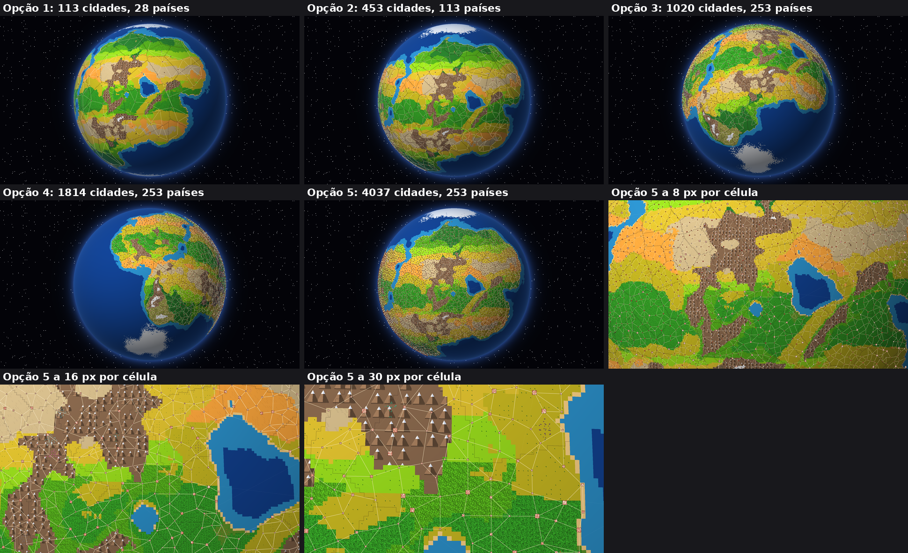
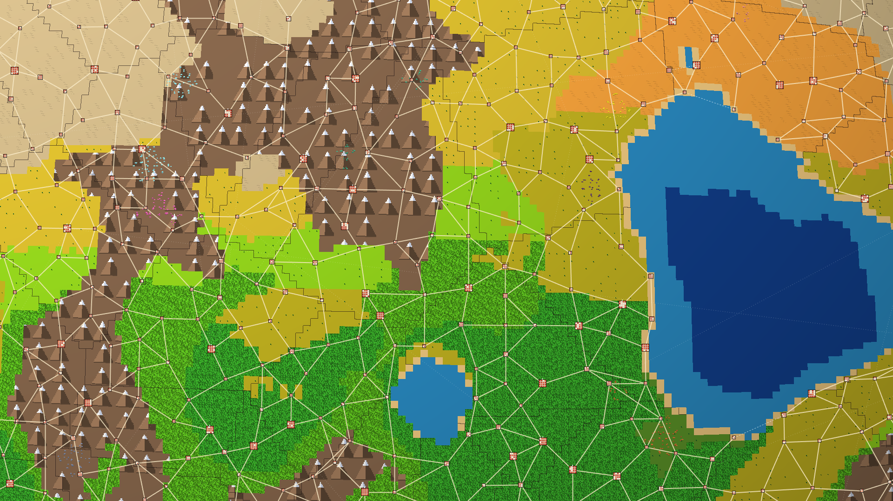

# Portão do M3: prova da escala (item 1.4)

Pergunta: quantos países e cidades cabem nas opções 1 a 5 com densidade parecida com a da Europa e da Ásia, e como o mundo fica de longe? As contas são de distribuição, feitas no mundo gerado: **nenhuma simulação de humanos existe ainda**.

## Como contei
- **Países:** Europa e Ásia somam cerca de 93 países em cerca de 55 milhões de km² (dados conhecidos, arredondados), ou seja, 1 país a cada ~590 mil km². Com os ~149 milhões de km² de terra da Terra, isso dá **~253 países**.
- **Cidades:** o número de referência é **~4.000 cidades com mais de 100 mil habitantes no mundo**. A fonte é fraca: um mapa de internet que cita [4.037 cidades](https://brilliantmaps.com/4037-100000-person-cities/), com lacunas conhecidas e dados antigos. Não achei a contagem por continente. Serve como ordem de grandeza, e a Eurásia deve ser mais densa que essa média.
- **Tamanho das cidades, escolha minha:** a cada 20 cidades, 1 grande (17 células de lado), 4 médias (9) e 15 pequenas (5). Dá ~39 células por cidade. O boneco tem ~1/3 de célula, como antes.
- **Limite, escolha minha:** cidades ocupando no máximo **15% da terra**, para sobrar campo, floresta e mina. Mudar qualquer uma dessas duas escolhas muda as contas abaixo, mas não a ordem das opções.
- Pelo menos 4 cidades por país.

## Resultado

| Opção | Terra (células) | Cidades que cabem até 15% | Países | Terra ocupada para ter as ~4.000 | Geração do mundo (navegador) | Cabe nas metas? |
|---|---:|---:|---:|---:|---:|---|
| 1 Menor, `n`=128 | 29 mil | 113 | 28 | 534%: impossível | 0,38 s | Sim, mas é um mundo vazio |
| 2 Hoje, `n`=256 | 118 mil | 453 | 113 | 134%: impossível | 1,12 s | Sim, mas não dá para cobrir |
| 3 Maior, `n`=384 | 265 mil | 1.020 | 253 | 59% | 2,27 s (meta 1,5 s) | **Não** na geração |
| 4 Bem maior, `n`=512 | 472 mil | 1.814 | 253 | 33% | 3,78 s (meta 1,5 s) | **Não** na geração |
| **5 `n`=256 com detalhe 4× (recomendo)** | 118 mil grandes, **1,9 milhão finas** | **7.259** (uso 4.037) | **253** | **8%** | 1,13 s + pedaços | **Sim, medido** |

**A opção 5 é a única em que cabem as ~4.000 cidades e os ~253 países com terra de sobra.** Nas opções 3 e 4 o mundo teria metade ou um quarto das cidades, e ainda estouraria a geração.

Medidas da recomposição nas opções 1 a 4 (só as da primeira rodada, em Node): 0,23 · 0,39 · 0,79 · 1,33 s.

## Como o mundo fica de longe
Mesmo tamanho de símbolo nos cinco globos: países (linhas escuras), estradas (claras), rotas marítimas (tracejado) e aéreas (pontilhado). Nas opções 1 a 4 a ocupação é a da tabela. Os mundos são gerados de novo em cada tamanho, por isso os continentes mudam entre as imagens.

### Na opção 5, a cidade de longe vira quase um ponto. Como ela aparece
O 2D de longe a desenha como **símbolo de mapa**, maior que o tamanho real dela, crescendo com o zoom: 3 tamanhos, quarteirões de telhado vermelho, capital com um ponto branco, estradas ligando as vizinhas. É isso que faz o mundo parecer coberto.

16 px por célula, em tamanho real:

8 px e 30 px estão na folha acima.

**Isto é desenho sobre o globo, feito para a imagem**, sem medir o custo. Com 4.037 cidades, desenhar por cima leva tempo de desenho; no jogo seria parte da mesma técnica do 2D de longe, e o custo fica para medir quando a escala for escolhida. As estradas ligam as vizinhas mais próximas e formam uma teia regular: é uma ilustração, não um traçado de verdade.

## Gerador mínimo do detalhe 4× (medido no protótipo, build de produção)
A partir da grade grande, gera na hora relevo, costa e bordas de bioma onduladas, rios, vegetação, jazidas e cidades. Mesma posição, mesmo resultado.

| O que | Medido | Meta |
|---|---|---|
| Geração do mundo | 1,13 s; abertura 1,29 s | ≤ 1,5 s; ≤ 2,5 s |
| Um pedaço de 32×32 células finas, no ajudante | média 8,5 ms, pior 42 ms | fora da tela |
| Subir um pedaço para a GPU | média 0,23 ms, pior 0,7 ms | |
| Recomposição: refazer tudo à vista (40 pedaços) | 607 ms em segundo plano, pior quadro 17 ms; 11 ms na tela | ≤ 1 s sem travar |
| Memória dos pedaços | 21 MB na GPU (até ~30 MB andando) + 2 mapas de sombra | total ≤ 400 MB |
| GPU | 5,9–7,3 ms de média; picos abaixo | ≤ 8 ms |

**Limites:**
- A "recomposição" aqui altera as alturas de propósito; ela mede o custo de refazer o detalhe, sem a geologia real rodando junto.
- A memória da página toda não foi medida com a geologia junto; o relatório do protótipo só soma os dados dele.
- O que os humanos fizerem em cada lugar (M4) precisa ser guardado à parte, porque o detalhe é refeito da grade grande. Esse custo não está aqui.
- 4.000 cidades simuladas não foram testadas. O plano é o registrado: de longe números, de perto indivíduos.
- Os pedaços param na aresta da face do cubo no protótipo; no jogo eles precisam atravessar.

## Decisão
Opção 1 a 5. **Recomendo a 5.**
