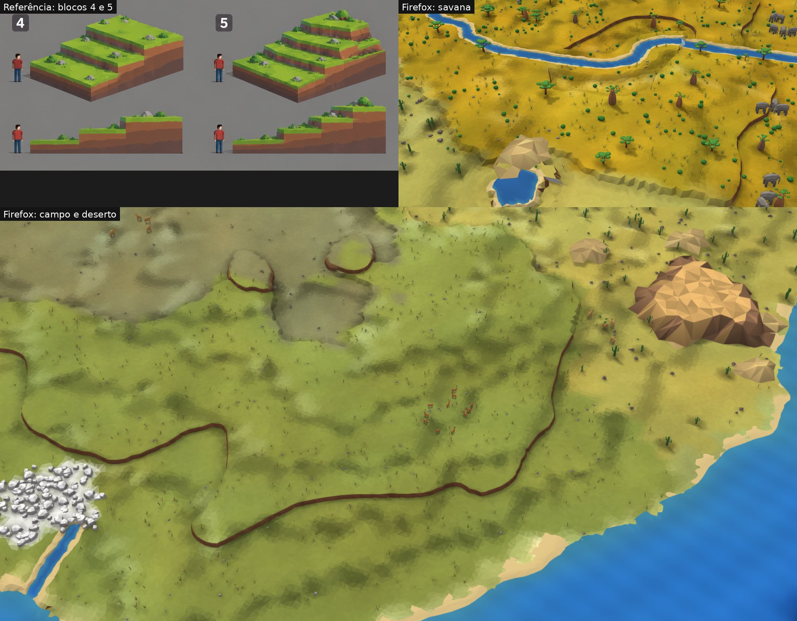
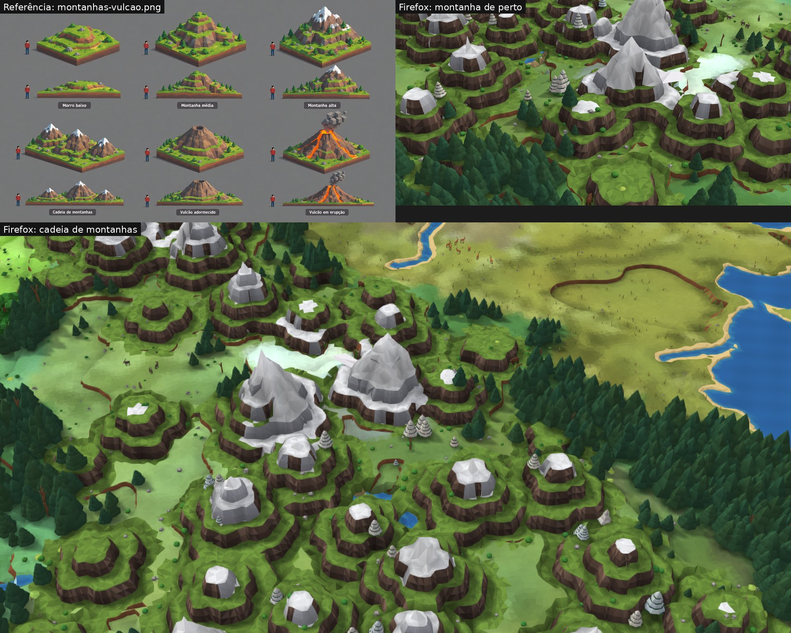
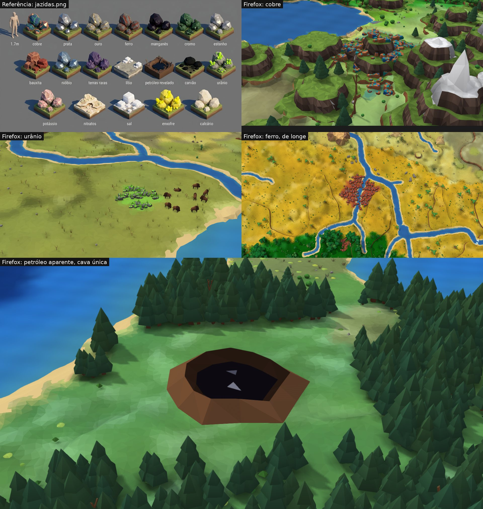
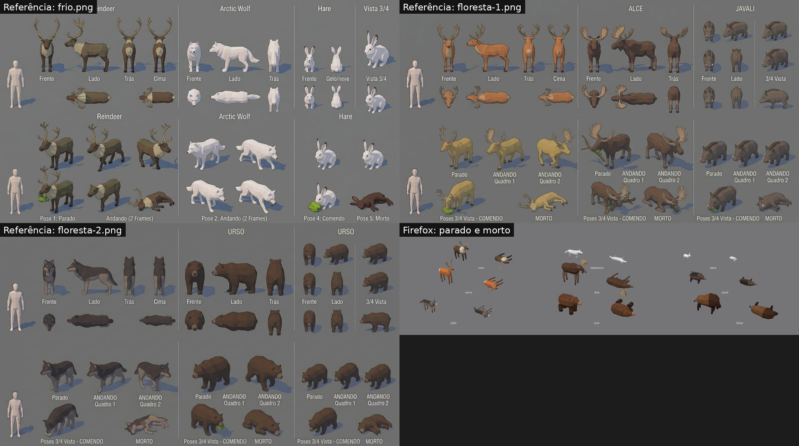
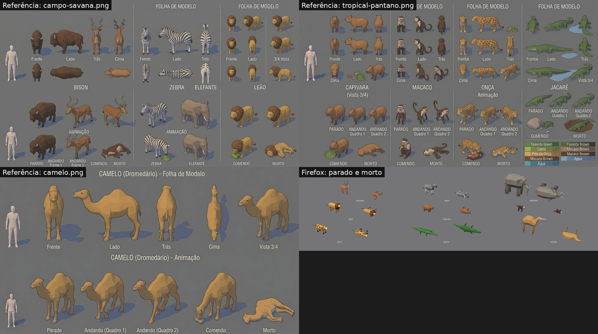
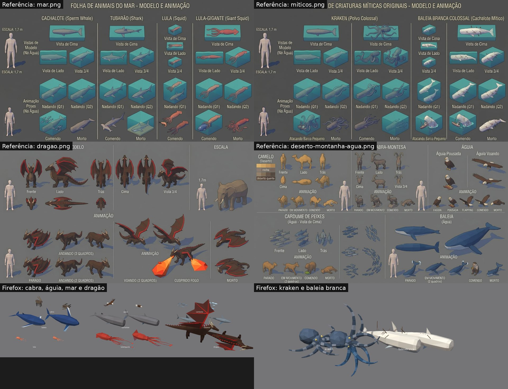
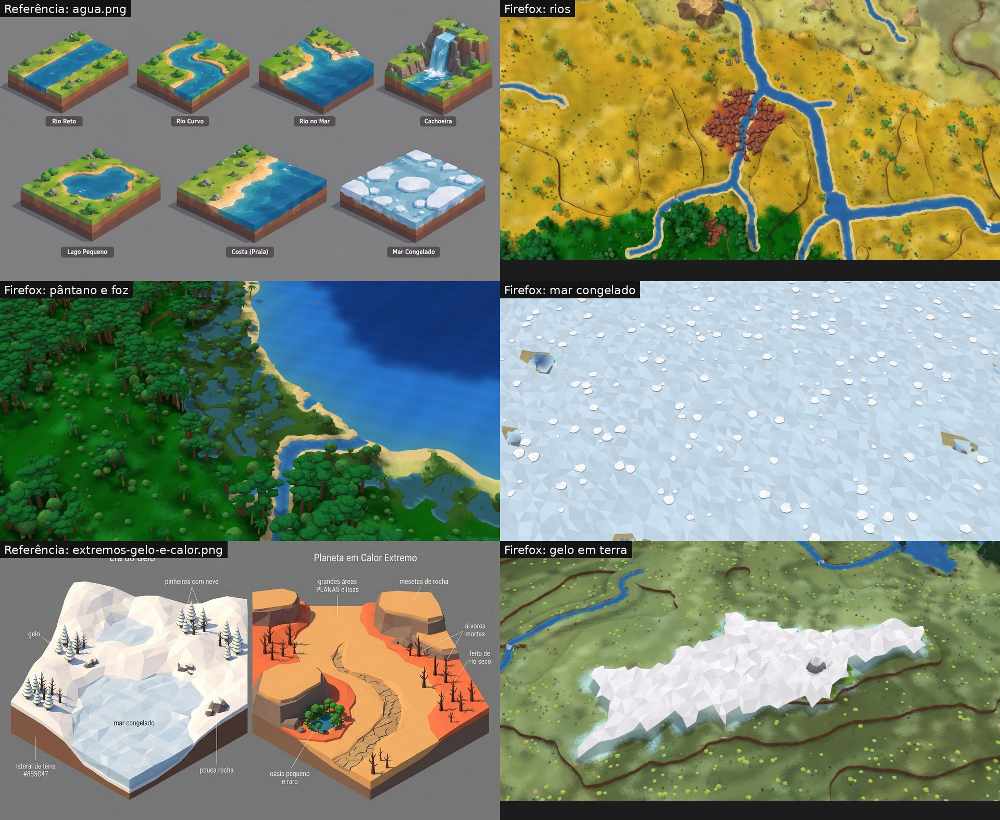
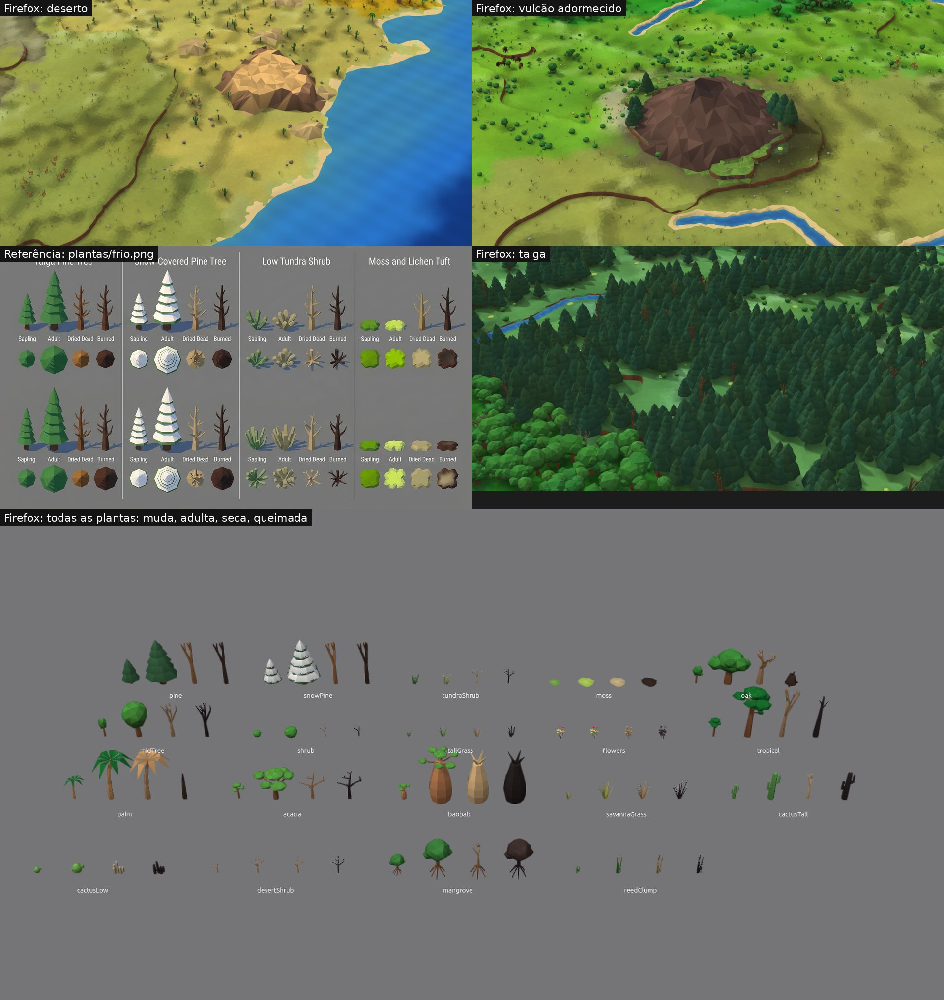

# M3: fidelidade às referências (P1 a P7)

Capturas no **Firefox 158, em janela de 1920×1080**, num compositor sem tela (nada aparece na tela do usuário), mundo de semente `terra`. Cada defeito foi reproduzido antes de corrigir. À esquerda a folha de `docs/img/referencias/`, à direita o jogo.

| Item | O que ficou igual | O que ainda difere | Por quê |
|---|---|---|---|
| **P1 Terraços** | Patamares planos e limpos; parede de terra à vista entre dois patamares, sem lasca nem risco solto | Vista quase de cima (logo depois do corte), a parede vira uma linha fina; a grama da folha é mais clara | A parede tem 0,85 de altura e a câmera do corte olha de cima; a cor do chão vem do globo (decisão de 2026-11-06) |
| **P2 Montanhas** | Encostas em degraus altos, parede de rocha marrom facetada, patamar de grama com pinheiros, arbustos e pedras, neve a partir de um patamar e cume em ponta | Os degraus são mais regulares que os da folha (parecem camadas); a neve fica mais cinza na sombra | Os degraus saem da mesma regra dos terraços (um a cada 3 níveis); a luz é a da maquete |
| **P3 Jazidas** | Cada minério com a cor da folha, lida de longe (mancha no chão) e de perto (rocha): cobre laranja com verde-azulado e azul, ferro com ferrugem, urânio cinza com cristais verdes, enxofre amarelo, sal e lítio com cubos | São lajes aflorando, não os montes de pedra redonda da folha | Decisão do usuário de 2026-11-06: afloramento; montes e pedras soltas só quando minerar (M4) |
| **P3 Petróleo** | Cava única e grande, borda de terra, poça preta com reflexos, em chão aplainado | Os dois paus da folha quase não se veem de longe | São finos; ficam para o acabamento |
| **P4 Animais de terra** | Silhueta, proporção e cores das folhas: galhadas, corcova do bisão e do camelo, juba, listras de verdade na zebra, pintas e cauda de anéis na onça, orelhas, tromba e presas do elefante, chifres em arco da cabra | Facetas maiores e menos detalhe na cara; a pá do alce é plana; "comendo" e "andando" são movimento no jogo, não poses separadas | Modelos de poucas faces para caber centenas na tela; o andar e o comer são animados no desenho |
| **P4 Mar e míticos** | Baleia, cachalote, tubarão, lula e lula-gigante inteiros e azulados dentro da água; dragão (asas de membrana, hastes e crista vermelhas, chifres claros), kraken e baleia branca com cicatrizes e arpões | A água é opaca: o bicho fica na superfície, não no fundo; o kraken tem braços mais finos que os da folha | Água transparente mexeria em toda a água (custo de GPU a medir); míticos só entram no mundo pelas mãos de deus (E7) |
| **P5 Plantas** | As 19 espécies nos 4 estados (muda, adulta, seca, queimada), já conferidas no bloco anterior | Nada novo | |
| **P5 Água** | Rios em curva (antes vinham em escada e em cruz), margem de areia, cachoeira no degrau, lago, foz, pântano com charcos, mar congelado com placas | Rio sempre da mesma largura por trecho; sem ondas na costa | Os rios são só desenho (decisão de 2026-11-06) |
| **P5 Gelo** | Manto branco facetado em terra, sem pontas penduradas na borda; mar congelado azul-claro | O gelo da folha é mais alto e mais quebrado | Fica para a parte física dos extremos (E9) |
| **P5 Deserto** | Áreas planas grandes, dunas cor de areia, mesetas de topo plano, cactos e pedras | As dunas são morros facetados, não cristas longas | Forma simples; cristas ficam para o acabamento |
| **P5 Vulcão** | Cone de rocha com cratera, lava e fumaça em erupção (do bloco anterior); cratera menor | O cone é liso, sem os degraus da base da folha | Continua faceta por cima do chão |
| **P6 Recomposição da maquete** | **865 ms** (meta 1 s), pior quadro 41 ms | | Antes 3.374 ms: só 2 pedaços subiam para a GPU por quadro; agora quem limita é o tempo (3 ms por quadro) |
| **P7 Intervalos de 130 a 380 ms** | Vêm da tela virtual, e um deles vinha do jogo, que foi corrigido | | Ver abaixo |

## P1 Terraços

## P2 Montanhas

## P3 Jazidas e petróleo

## P4 Animais

## P5 Água, gelo, deserto, vulcão e plantas

## P6 Recomposição da maquete
"Medir desempenho" completo no Firefox, build de produção, 1920×1080, relógio da GPU ligado, na tomada:

| Medida | Antes | Agora | Meta |
|---|---:|---:|---:|
| Refazer tudo à vista | 3.374 ms | 865 ms | ≤ 1.000 ms |
| Pior quadro durante | 295 ms | 41 ms | ≤ 50 ms |
| Montar um pedaço no ajudante | 6,5 ms (pior 34) | 10,5 ms (pior 46) | |
| GPU da maquete | | 3,0 a 3,4 ms (pior 3,9) | ≤ 8 ms |

Montar um pedaço ficou mais caro (os terraços cortam cada triângulo), e mesmo assim a vista inteira se refaz dentro da meta.

## P7 De onde vêm os intervalos de 130 a 380 ms
Medido quadro a quadro, na mesma janela do Firefox no compositor sem tela:

| O que estava na janela | Tempo | Intervalos acima de 100 ms |
|---|---:|---|
| Página vazia | 10 s | nenhum |
| WebGL mínimo (só limpa a tela, sem o jogo) | 40 s | 1, de 134 ms |
| Jogo na maquete, pausado | 40 s | nenhum |
| Jogo na maquete, 1× | 40 s | 1, de 224 ms |
| Jogo na maquete, 1×, andando e carregando pedaços | 40 s | nenhum |

- **Tela virtual:** o intervalo aparece numa página que só limpa a tela, sem uma linha do jogo, na mesma frequência (cerca de 1 a cada 40 s). Nesses quadros o trabalho da tela do jogo ficou abaixo de 30 ms. O relatório os marca como "tela livre esperando o quadro".
- **Jogo, corrigido:** com placas a 100% em 5×, apareceram 2 quadros de 49 e 65 ms dentro do código da tela. Causa: a cada quadro o jogo lia o tamanho do canvas, e isso obrigava o Firefox a refazer o leiaute da página ali mesmo quando um aviso ou a data tinham mudado. Agora o navegador avisa quando o tamanho muda e o quadro só usa o valor avisado. Na repetição de 90 s não voltou.
- **Limite:** não reproduzi os intervalos de 300 ms a cada ~10 s do relatório de 2026-11-06. O teste no Firefox do usuário, em tela cheia, decide.
