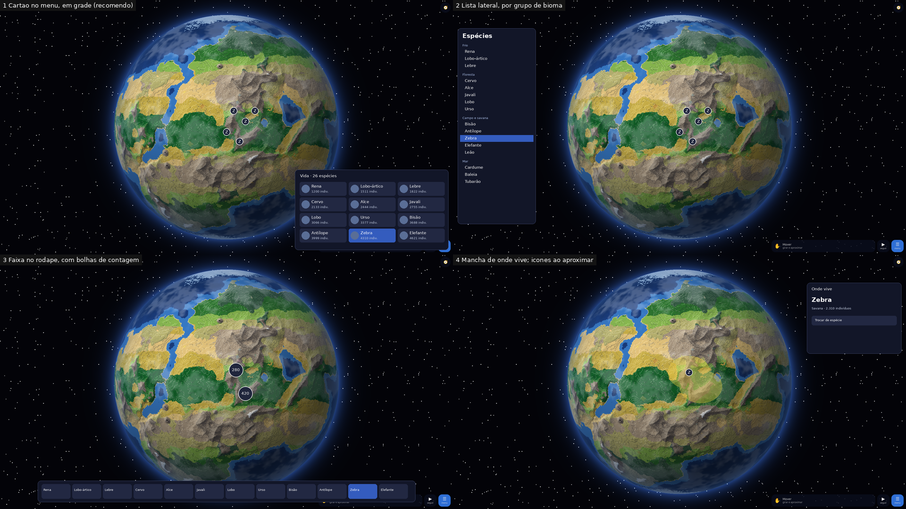

# Decisão: lista de espécies no menu, com ícones no globo

Maquetes de interface sobre uma captura do Firefox a 1920×1080. **Os números são de exemplo:** a população só existe depois da ecologia (E2). Nada desta página tem código.

| Opção | Como funciona | Trabalho | Desempenho |
|---|---|---|---|
| **1 Cartão no menu, em grade (recomendo)** | Novo cartão "Vida" no menu, como os outros; tocar numa espécie põe ícones no globo | Pouco: usa o cartão que já existe | Só desenha ícones de uma espécie |
| 2 Lista lateral, por grupo de bioma | Painel próprio à esquerda, com rolagem | Médio: painel novo; cobre parte do globo | Igual |
| 3 Faixa no rodapé com bolhas de contagem | Espécies em fila; no globo, uma bolha por região com o número | Médio: agrupar os ícones por zoom | Igual, com conta extra de agrupamento |
| 4 Mancha de onde vive | Mancha colorida de longe e ícones só ao aproximar | Grande: a mancha entra no desenho do globo aprovado | Custo a medir no globo |

**Recomendo a 1:** é o mesmo gesto do resto do jogo, funciona bem por toque, e não mexe no globo aprovado. O ícone de cada espécie sai de uma pose das folhas em `animais/`.
