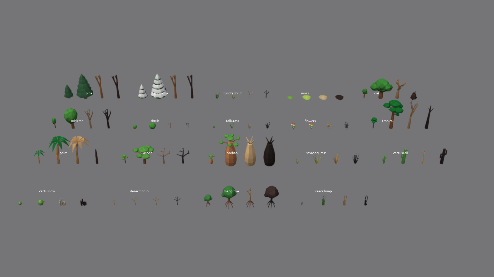
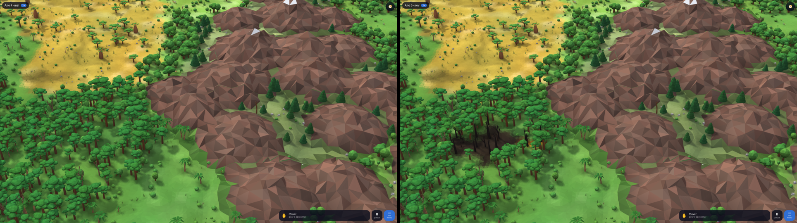
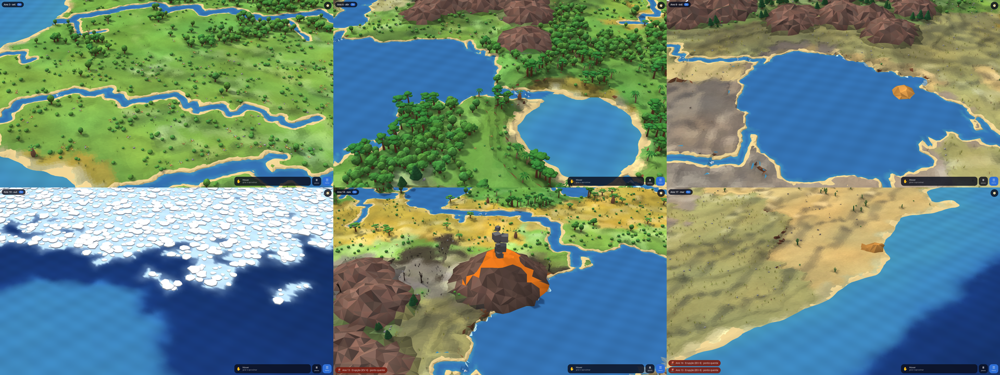
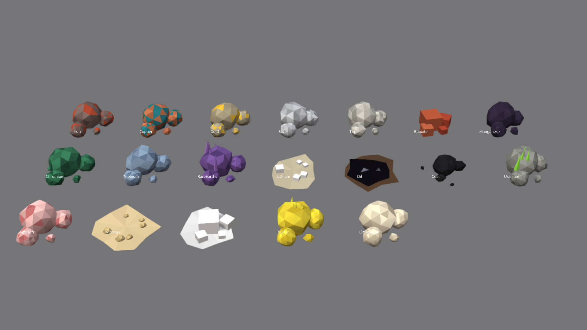
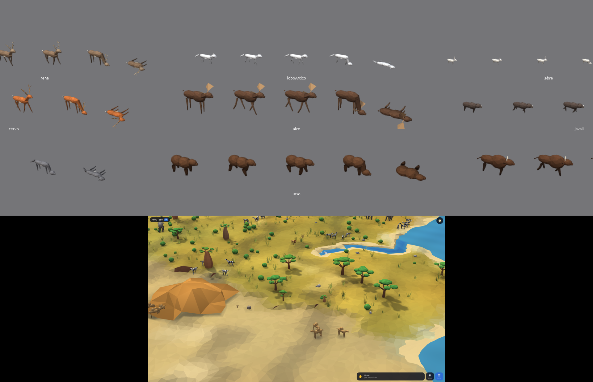

# Maquete dentro do jogo (T2 e T3)

## Como funciona
- **Passagem:** a 18 px por célula grande os pedaços começam a carregar, ainda com o globo na tela. A 32 px a vista crava na maquete do mesmo lugar, com o mesmo "para cima" da tela. Globo e maquete nunca aparecem juntos. Afastando além do limite, ou se o tempo geológico travar o zoom, volta ao globo.
- **Comandos:** a câmera é uma só (`src/render/view-camera.ts`). Na maquete, ↑/↓, roda e pinça aproximam, ←/→ giram e arrastar anda. Toque, pincéis, desastres e animações usam o mesmo ponto do planeta das duas vistas.
- **Pedaços:** 32×32 células finas (4 por célula grande), montados num ajudante próprio (`src/maquete/worker.ts`) a partir de uma cópia do chão. Com o relógio andando, a cópia é refeita 1 vez por segundo e só os pedaços com células mudadas são refeitos.
- **Aresta do cubo:** cada pedaço é montado nas coordenadas da própria face. Um mapa plano (`src/maquete/chart.ts`) abre as faces vizinhas em volta da face central, giradas de 90° em 90°. Trocar de face central não refaz nenhum pedaço.
- **Canto do cubo:** nos 8 cantos só 3 faces se encontram e sobra um quadrante vazio. Ele é preenchido em leque, copiando a aresta. **Limite:** nesse quadrante o relevo forma anéis.
- **Borda:** os lados sem vizinho carregado mostram as camadas de terra. O que está na vista é sempre carregado, então a borda só aparece de relance, enquanto os pedaços chegam.

## O globo achatado
**Causa:** só no protótipo apagado, que media a tela uma vez, ao abrir. Em tela cheia a imagem interna ficava em 1854×961, esticada para 1920×1080. **Reproduzido** numa janela real antes de apagar.

**O jogo não tem esse defeito:** ele mede a tela a cada quadro. Conferido em janelas reais (largura ÷ altura do globo, medidas na imagem):

| Janela | Razão |
|---|---:|
| 1920×1080, tela cheia | 1,000 |
| 1390×699 | 0,998 |
| 880×790 | 1,024 |
| 1480×490 | 1,000 |

Os 2,4% da janela 880×790 são o traçado do litoral e das nuvens na medida automática, que varre a imagem a partir do centro; a conta do desenho é a mesma nas quatro.

## Conferido em janela real de 1920×1080
Pinça entra na maquete; ← gira; arrastar anda; o menu abre (com o véu escuro de sempre do M2); desastre e toque caem no ponto certo e o fogo aparece; atravessei da face 4 para a 0 sem salto; ↓ volta ao globo. Nenhum erro no console.

## Capturas
Toda captura sai de um navegador em janela, com a GPU do notebook, num compositor sem tela (`gnome-shell --headless`): é janela de verdade e não aparece na tela do usuário.

## Plantas por bioma (T4)
As 19 espécies das folhas em `plantas/`, nos estados muda, adulta, seca e queimada (`src/maquete/plants.ts`), com as correções do `LEIAME.md`. A página `prototipo/folhas.html` mostra todas no motor. Em cada espécie, da esquerda para a direita: muda, adulta, seca e queimada.

Cada bioma tem as próprias espécies, com matas agrupadas. Taiga muito fria usa o pinheiro com neve. No mundo, cerca de 12% das plantas são mudas e 2% estão secas. Onde a vegetação volta depois de um desastre, nascem mudas.

**O fogo do M2 deixa as árvores queimadas:** a célula em chamas, queimada ou com cinza usa o modelo queimado. A cópia do mundo chega a cada segundo e só os pedaços mudados são refeitos.

## Água, relevo e vulcões (T5)

- **Rios e lagos (`src/maquete/rivers.ts`):** só para o desenho; a simulação não sabe deles. As bacias enchem a partir do mar, a chuva de cada bioma desce e o que junta água bastante vira rio. Bacia funda vira lago. Os rios são refeitos quando o relevo muda.
- **Cachoeira:** degrau no nível da água, com espuma no pé. **Costa:** areia com contorno nítido, só perto do mar e dos rios.
- **Mar congelado:** água clara com placas de gelo. **Deserto:** patamares muito mais largos, com dunas facetadas de vez em quando.
- **Montanhas:** picos separados, da altura que o mundo tem ali, com chapéu de neve. **Vulcões:** os do M2, com cratera. Em erupção, lava na cratera e nos canais, e fumaça em cubos.

**Limite:** o nível dos rios sobe e desce em patamares; os rios não passam acima de 1.900 m.

## Jazidas e petróleo (T6)

As 19 jazidas de `recursos/jazidas.png`, como amontoados de pedras facetadas com veios, cristais ou cubos (`src/maquete/deposits.ts`). Rótulos desta folha em inglês: são os nomes usados no código. **Petróleo misto:** cerca de 30% das manchas de petróleo afloram na maquete como poça preta e brilhante, com borda de terra; o resto segue invisível até cavar. **Limite:** isso é só desenho, para o globo do M2 e o mundo não mudarem. Tocar na poça ainda não diz "petróleo"; o jogo só conta como revelado o que foi cavado. O M4 decide o uso.

## Animais (T7)

As 26 espécies aprovadas, nos biomas certos, com 5 poses (parado, 2 quadros de andar, comendo, morto), em `src/maquete/animals.ts`. Andam ao acaso e não saem do pedaço onde nasceram (`src/render/maquete-animals.ts`). Cerca de 2,5% aparecem deitados, só para a pose existir. Sem fome, caça, nascimento ou morte de verdade: isso vem com a especificação do M3. Kraken, baleia branca e dragão são da classe mítica e não aparecem sozinhos.

**O que difere das folhas:** os corpos são mais simples, as listras da zebra e as pintas da onça saem por faceta, sem o desenho fino. A água é opaca: os animais do mar aparecem só com a parte que passa da superfície, por isso a lula e o cardume quase não se veem.

## Desempenho (T9)
Build de produção, navegador com a GPU do notebook, 1080p, na tomada. Relatório inteiro em `docs/medicao-m3-maquete.txt`. **A verdade é o "Medir desempenho" no Chrome do usuário.**

| Medida (meta) | Antes das técnicas | Depois |
|---|---:|---:|
| GPU na entrada da maquete, cenário do relatório (≤ 8 ms) | 10,4 ms | 3,7 ms (pior 5,5) |
| GPU na mata mais densa do planeta, de 1× a 5,6× de zoom (≤ 8 ms) | | 4,5–8,0 ms de média; quadros isolados até 9,8 ms na taiga |
| Triângulos na entrada | 1,22 milhão | ~660 mil |
| Pior quadro andando e correndo (nenhum > 50 ms) | 298 ms | 17 ms (no relatório todo, 33 ms, em desastres "Muitos" a 20×) |
| fps nos cenários (60) | 52–56 | 60 de média; mínimo 59 |
| Montar um pedaço no ajudante, pior | 355 ms | 31 ms (média 5,9 ms) |
| Memória da página (≤ 400 MB) | | 218 MB |
| Geração (≤ 1,5 s) / abertura (≤ 2,5 s) | | 0,91 s / 1,44 s |
| Recomposição à vista na maquete (≤ 1 s) | | 795 ms em segundo plano, pior quadro 17 ms |
| Travadas | | 0 da tela; 1 da data (326 ms, ao ligar as placas depois de muito tempo paradas) |

**Técnicas (regra 16, nada some da tela):** modelos de longe com a mesma silhueta e menos faces, a partir de 170 unidades da câmera; sombra desenhada em partes em 2 mapas, com os modelos de longe; fundo do mar coberto não é desenhado; mar aberto em blocos de 4 células; recorte do que está fora da vista; plantas antes do chão; uma amostra de sombra de longe; programas compilados atrás da tela de carregamento; e a sombra já começa a ser feita antes do corte.

**Janela real e medição:** o quadro em janela no compositor sem tela oscila (o relógio dele não é o da tela). As imagens saem da janela; os números de fps saem do navegador com GPU real sem janela, como em todas as medições anteriores.

## Cor no corte (decisão 2)
Média de uma faixa no centro da tela, mesmo lugar, 1 quadro de globo a 31 px e maquete a 33 px, com as nuvens desligadas. Diferença em 0–255:

| Bioma | Globo | Maquete | Maior diferença |
|---|---|---|---:|
| taiga | [49, 91, 63] | [44, 74, 46] | 18 |
| floresta | [38, 110, 38] | [45, 102, 39] | 8 |
| campo | [111, 157, 54] | [109, 153, 62] | 8 |
| estepe | [159, 153, 85] | [150, 159, 76] | 9 |
| deserto | [197, 167, 99] | [186, 176, 91] | 11 |
| savana | [172, 146, 44] | [163, 144, 58] | 14 |
| tropical | [12, 90, 33] | [38, 97, 46] | 25 |
| pântano | [48, 98, 76] | [59, 107, 89] | 13 |
| montanha | [130, 117, 103] | [120, 100, 89] | 17 |
| tundra | [122, 130, 100] | [111, 133, 90] | 11 |
| mar raso | [34, 103, 183] | [43, 118, 196] | 15 |

A cor vem da célula do globo (com estado, vegetação e clima). A calibração está em `src/maquete/world-fields.ts` (`globeR/G/B`, `BIOME_FIX`). Variam de um lado do corte: a luz e a sombra, que a maquete acrescenta. **Limite:** floresta tropical e taiga ainda têm a maior diferença.
