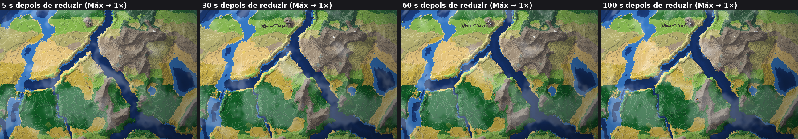
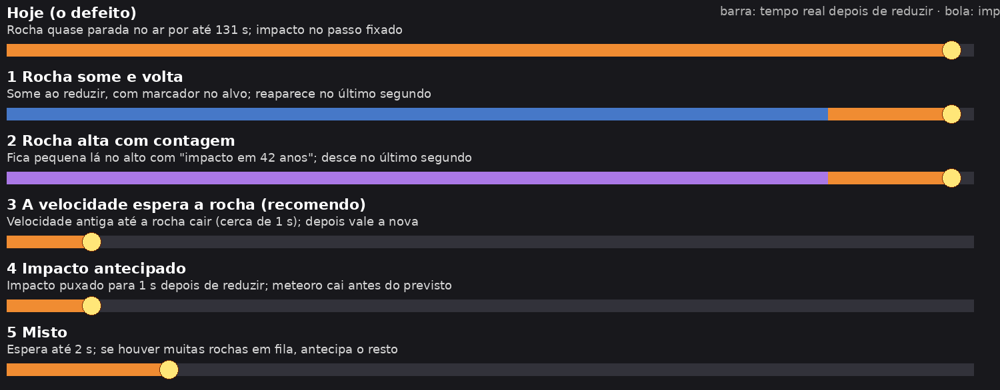

# Meteoro ao reduzir a velocidade na queda

## Aplicado: opção 3, a velocidade espera a rocha (T8, decisão do usuário de 2026-11-06)
O botão muda na hora; o relógio segue na velocidade antiga até a rocha à vista cair. Acelerar e pausar valem na hora. O mundo não muda.

Medido em janela real, com um meteoro pedido e a velocidade reduzida 150 ms depois:

| De → para | Antes | Agora (espera) |
|---|---:|---:|
| Máx → 1× | 130,8 s | 1,2 s |
| Máx → 20× | 6,5 s | 0,35 s |
| 20× → 1× | 13,5 s | 0,87 s |
| 5× → 1× | 3,5 s | 0,86 s |

**"Muitos" no Máx, 14 reduções (tempo até o relógio desacelerar, em segundos):** 3,6 · 1,4 · 0,6 · 1,5 · 2,9 · 1,4 · 1,5 · 1,1 · 0,5 · 0,5 · 1,8 · 2,0 · 0,9 · 0,8. Mediana 1,4 s; **3 de 14 chegaram a 2 s ou mais** (a maior, 3,6 s), porque outra rocha entra durante a espera. Pela regra do usuário, a opção 5 volta para ele decidir; o jogo fica com a 3.

---

# O que foi proposto antes (item 5 do portão)

## O defeito, reproduzido no jogo atual
Pedi um meteoro e reduzi a velocidade logo depois, no navegador com a GPU real:

| De → para | A rocha demorou para cair, depois de reduzir |
|---|---:|
| 5× → 1× | 3,5 s |
| 20× → 1× | 13,5 s |
| Máx → 20× | 6,5 s |
| Máx → 5× | 29–34 s |
| **Máx → 1×** | **130,8 s** |

**Causa:** o passo do impacto é fixado ao nascer o meteoro (2.200 passos no Máx). Depois de reduzir, esses passos andam a 12 por segundo em 1×, e a rocha só anda conforme eles passam. O mundo está certo; o que fica ruim é o que se vê.

Quadros do Máx → 1×, em tamanho real: a rocha quase não sai do lugar.

## Opções
Esquema de cada uma (barra: tempo real depois de reduzir; bola: o impacto):

| Opção | Trabalho | Desempenho | O que muda no jogo |
|---|---|---|---|
| 1 Rocha some e volta | Pouco, só na tela | Igual | Marcador no alvo até o último segundo. O mundo segue igual. Até 131 s de espera, sem nada caindo |
| 2 Rocha alta com contagem | Pouco, só na tela | Igual | Rocha pequena no alto e "impacto em 42 anos". O mundo segue igual. A mesma espera, mas explicada |
| **3 A velocidade espera a rocha (recomendo)** | Pouco: o relógio segura a troca | Igual | O botão muda na hora, e o tempo só desacelera depois do impacto (~1 s). O mundo segue igual |
| 4 Impacto antecipado | Médio, mexe na simulação | Igual | Cai em 1 s depois de reduzir. O impacto muda de passo, então o mundo passa a depender de quando o jogador reduziu, inclusive nos naturais |
| 5 Misto (3 com limite de 2 s, depois 4) | Maior | Igual | Em "Muitos" a espera não se acumula; herda o efeito da 4 quando o limite estoura |

**Recomendo a 3:** é a menor mudança e deixa a queda de ~1 s como está. O efeito a saber: em "Muitos", no Máx, sempre pode haver uma rocha caindo, e a redução poderia demorar mais de 1 s. Ainda não medi quanto. Se você escolher a 3, eu meço, e se passar de 2 s proponho a 5.

Em todas, reduzir com a rocha já perto do chão não muda nada visível. Pausar não entra aqui: fica como é hoje.

Código só depois da sua escolha.
