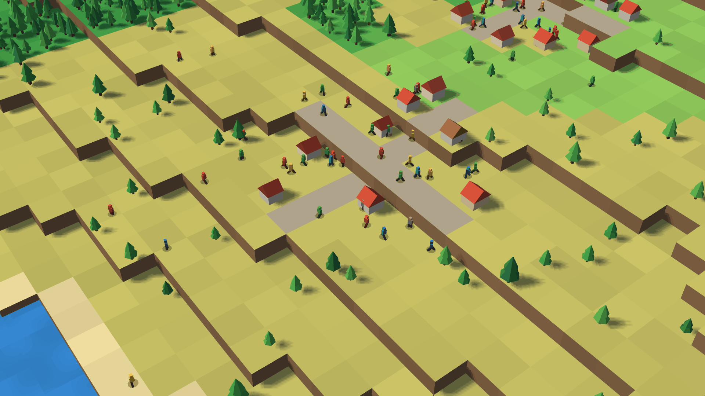
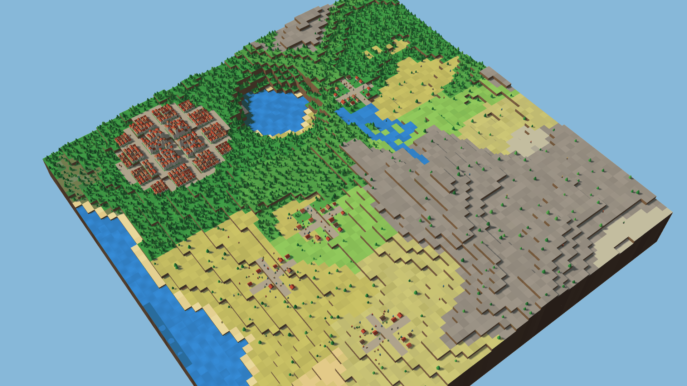
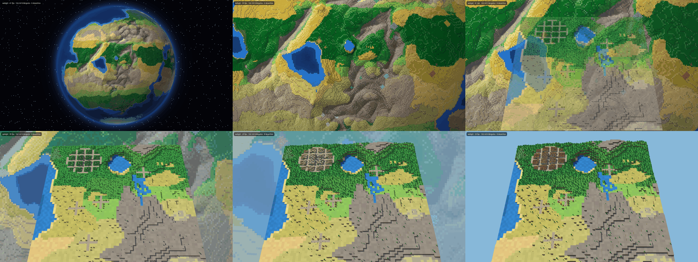
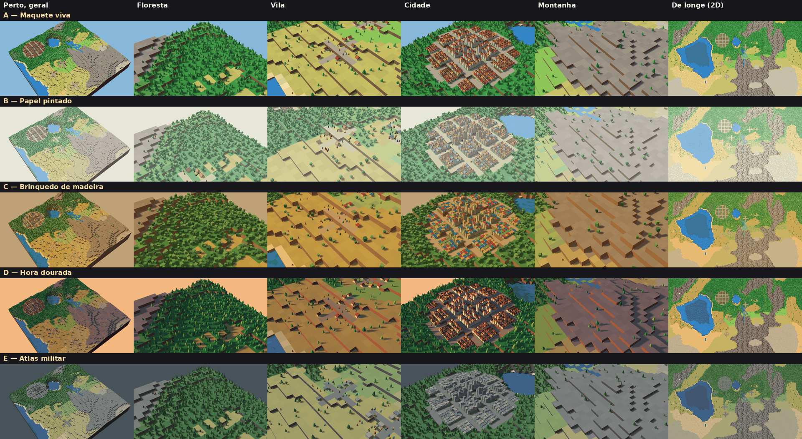
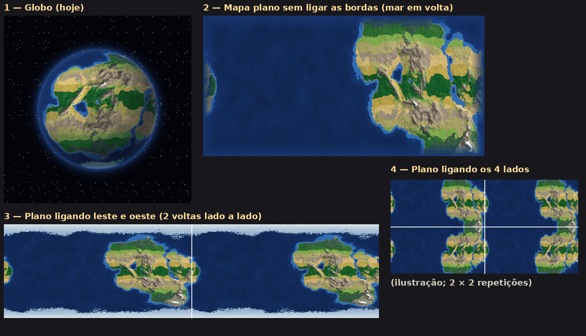
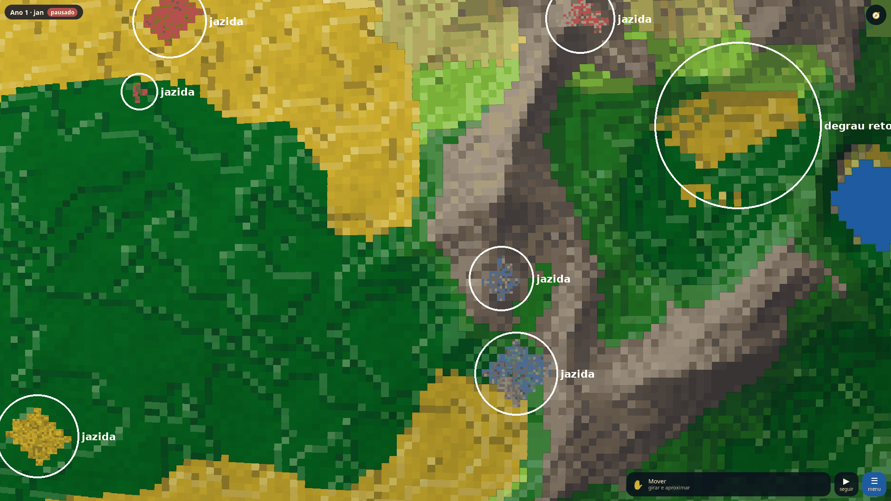
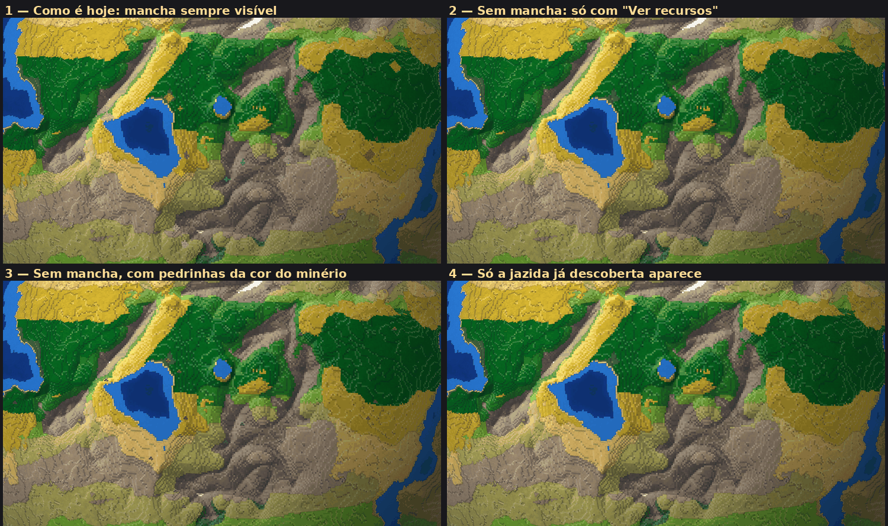

# Portão do M3 — opções para o usuário decidir

**Segundo bloco (2026-11-05, depois das decisões do usuário em `docs/decisoes.md`):**
- **Decisões visuais:** `docs/M3-decisoes-visuais.md` (paleta, passagem entre níveis, 2D de longe).
- **Prova da escala:** `docs/M3-escala.md`. **Meteoro:** `docs/M3-meteoro.md`.
- **Protótipo:** https://berzeruska.github.io/sandbox-mundo/previa/atual/prototipo/ · comparação de motores em `prototipo/antigo.html`.
- **Referências:** `docs/img/referencias/indice.png` e `LEIAME.md`.

## Medições do segundo bloco
Relatório completo do botão "Medir desempenho": `docs/medicao-m3-bloco-opcoes.txt`. Chromium sem janela, GPU real, 1080p, na tomada. **O portão só se aprova com a medição do usuário no Chrome.**

**Passagem e pedaços (1.5 e 1.6), carga 1×, com detalhe 4×:** 60 fps nos 10 cenários, pior quadro 17 ms, nenhum > 50 ms. GPU média: globo 4,3–5,1 ms, maquete 5,9–6,5 ms, andando 6,6 ms, correndo 7,3 ms. **Picos acima de 8 ms:** correndo 9,9 ms e ida e volta no corte 10,0 ms, em quadros isolados. Numa rodada só dos cenários de carregar, o pior foi 7,4 ms. A sombra é desenhada em partes para não pesar um quadro só. Espera no corte: 1 ms depois dos pedaços carregados. Limite: os pedaços param na aresta da face do cubo.

**Aviso sobre a GPU:** nas minhas medições a mesma cena deu ora ~6 ms, ora ~15 ms de GPU, sempre a 60 fps. O relógio da GPU oscila entre 200 e 1.900 MHz nesses momentos, e numa repetição controlada voltou a 6 ms. Atribuo ao relógio em baixa, sem ter provado que é a única causa. Se o seu relatório mostrar ~15 ms com 60 fps, repita antes de concluir.

**Suavização de bordas (4.2):** `img/m3/suavizacao.png`. GPU média (maquete parada · girando · rente ao chão · correndo):

| Modo | Carga 1× | Carga 3× | Carga 6× |
|---|---|---|---|
| MSAA 4× (hoje) | 7,2 · 6,5 · 6,4 · 7,8 | 8,6 · 7,8 · 7,8 · 8,5 | 9,5 · 9,1 · 9,0 · 10,1 |
| MSAA 2× | 6,3 · 5,7 · 5,5 · 6,7 | 7,4 · 6,6 · 6,3 · 7,3 | 8,1 · 7,5 · 7,0 · 8,2 |
| **FXAA no quadro final (recomendo e deixei no protótipo)** | 5,8 · 5,5 · 5,6 · 6,0 | 6,9 · 6,2 · 6,4 · 6,7 | 6,8 · 6,5 · 6,7 · 7,0 |
| Sem suavizar | 4,9 · 4,5 · 4,6 · 5,0 | 5,0 · 4,7 · 5,1 · 5,1 | 6,2 · 5,3 · 5,7 · 5,8 |

**Qualidade:** bordas tão lisas quanto as do MSAA 4×, mas o FXAA amolece um pouco o interior das faces; a 3× de zoom dá para ver, em tamanho normal quase não. Pela regra 16, se você achar que perdeu qualidade, a volta é o MSAA 2×, que é mais nítido e custa 1,2 ms a mais na carga 6×.

---

# Primeira rodada

Feito em 2026-11-05, depois do merge do M2 (`v2.0`). **Nada do M3 foi construído:** o protótipo fica em `prototipo/`, à parte
do jogo, e o jogo não importa nada dele. O M3 só começa depois das decisões do fim deste documento.

**Protótipo no ar:** https://berzeruska.github.io/sandbox-mundo/previa/marco-3/prototipo/
Na URL, depois do `?`: `motor=webgl2`, `three` ou `sprites`; `estilo=0` a `4` (A a E); `carga=3`; `aa=0`; `passagem=1`. Exemplo da
passagem: [`?passagem=1`](https://berzeruska.github.io/sandbox-mundo/previa/marco-3/prototipo/?passagem=1) (roda do mouse para aproximar).

**Limites do que foi medido:** Chromium sem janela, GPU real do notebook, 1080p, na tomada; o seu Chrome é quem decide. A cena é de verdade
(região de 64×64 células de um mundo gerado), mas parada no tempo: sem o relógio andando e sem o globo por baixo, exceto na passagem. **As referências de
estilo (`docs/img/referencias/`) não estão no repositório**: as opções saíram da descrição escrita em `docs/02-marcos.md`.

## (a) Diorama: WebGL2, Three.js e sprites

Mesma cena nos três: 3.172 árvores, 539 prédios, 240 bonecos andando, sol com sombra, relevo em degraus e rio. Meta: 60 fps e GPU ≤ 8 ms.
Medido girando a câmera: de longe, de perto e rente ao chão (`docs/medicao-m3-portao.json`). Fps de todos: 60, nenhum quadro > 50 ms, exceto onde indicado.

| Caminho | Carga | Triângulos | GPU média (longe · perto · chão), ms | Pior p95 | Tela por quadro |
|---|---:|---:|---|---:|---:|
| **WebGL2** (motor do jogo) | 1× | 102 mil | 5,9 · 5,5 · 5,8 | 6,7 | 0,2 ms |
| **Three.js** | 1× | 102 mil | 5,5 · 5,3 · 5,6 | 6,1 | 0,7 ms |
| **Sprites** (plano B) | 1× | | 5,8 · 5,9 · 7,0 | 7,8 | 0,2 ms |
| WebGL2, sem suavizar bordas | 1× | 102 mil | 4,5 · 4,4 · 4,4 | 5,3 | 0,2 ms |
| WebGL2 | 3× | 267 mil | 6,8 · 6,4 · 6,9 | 7,9 | 0,2 ms |
| Three.js | 3× | 267 mil | 6,6 · 6,7 · 7,0 | **9,3** | 0,8 ms |
| Sprites | 3× | | 7,5 · **9,0** · **10,8** | **11,7** | 0,2 ms |
| WebGL2 | 6× | 514 mil | **9,2** · **8,7** · **8,4** | **10,7** | 0,2 ms |
| WebGL2, sem suavizar bordas | 6× | 514 mil | 5,3 · 5,4 · 5,9 | 6,4 | 0,2 ms |
| Sprites | 6× | | **10,6** · **12,4** · **14,4** (54 fps no chão) | **15,3** | 0,4 ms |

- **Cabe na meta com folga na carga 1×; na 3×, cabe na média, com picos isolados de 8,5 ms.** Para ir além, o peso é a suavização de bordas (MSAA 4×): sem ela, 514 mil triângulos dão 5,9 ms. Regra 16: trocar por uma suavização mais barata no quadro final (técnica, sem perder qualidade), não simplesmente tirar. Ainda não testei isso.
- **Three.js empata na GPU** e custa 132 KB a mais de download (comprimido; o jogo inteiro hoje tem ~160 KB) e 0,5 ms a mais por quadro. O ganho seria escrever menos código para modelos e animação mais ricos. A luz dele aqui é por vértice, um pouco mais grosseira que a do WebGL2.
- **O plano B não ajuda neste notebook:** o custo está nos pixels, não nos triângulos, e os sprites são os piores com carga alta. Fica guardado para multidões muito distantes, sem uso previsto agora.
- Montar a região leva 24–30 ms; no jogo seria no worker. Memória da cena não medida.

| Opção do motor | Trabalho | Desempenho | Efeito no jogo |
|---|---|---|---|
| **1. WebGL2 direto (recomendo)** | Maior: escrevo tudo; já funciona para esta cena (~400 linhas) | O mais leve na tela, 0 KB a mais | Nenhum |
| 2. Three.js para o diorama, globo em WebGL2 | Menor para modelos ricos; dois motores no mesmo jogo | +132 KB, +0,5 ms por quadro | Nenhum |
| 3. Three.js para tudo | Reescrever o globo | Não medido; o globo tem shader próprio | Risco no que está aprovado |
| 4. WebGL2 com modelos feitos em programa externo | Ferramenta nova e carregador de modelos | Igual à opção 1, mais o peso dos arquivos | Modelos mais ricos |

## (b) A passagem de longe para perto

Ao aproximar, a partir de 8 px por célula, a região nasce em cima do globo exatamente no mesmo lugar; o relevo sobe, árvores e casas crescem, a câmera inclina e o globo some até 24 px por célula. Funciona no mesmo canvas do globo do jogo. Falta: hoje a região é fixa (no jogo ela acompanharia a câmera) e a maquete termina num fundo liso.

Medido no zoom parado e varrendo o zoom em 6 s: **60 fps em tudo, nenhum quadro lento.** GPU: só o globo, 4,6 ms; globo e maquete juntos, entre 8 e 24 px por célula, 8–10 ms de média e pico de 13,2 ms; maquete pronta, 6–6,7 ms. **Passa da meta de 8 ms enquanto os dois estão na tela**, e quem parar o zoom nesse trecho fica nesse custo. Para fechar, o globo em volta da maquete poderia ser desenhado mais simples nessa fase (técnica, sem mudar o que se vê); ainda não testei.

## (c) Guia de estilo: 5 opções

Cada linha é uma opção, no mesmo pedaço do mundo. A última coluna é a textura dos biomas no 2D de longe, com árvores uma a uma, montanhas e cidade. Só a A foi medida. As outras mudam cor, luz e forma das árvores e dos telhados, então espero custo parecido, **sem medir**. Veja ao vivo com `?estilo=0` a `4`.

| Opção | Ideia | O que muda |
|---|---|---|
| **A — Maquete viva** (recomendo, é a mais próxima do registrado) | Cores vivas, sol da manhã, pinheiros, telhado vermelho | Combina com "cores vivas, luz suave" |
| B — Papel pintado | Pastel, luz difusa | Calmo; a guerra e o fogo destacam mais, o relevo se lê menos |
| C — Brinquedo de madeira | Blocos, degraus altos, peças coloridas | Marcante e simpático; menos "mundo", mais "brinquedo" |
| D — Hora dourada | Sol baixo, sombra longa | O mais bonito em imagem; cansa como tela fixa de horas de jogo |
| E — Atlas militar | Sóbrio, cidades cinzentas | Combina com a guerra; pouca vida na fase da ecologia |

O 2D de longe ainda é uma imagem para escolher o estilo, não está no globo. Colocá-lo no shader tem custo estimado de 1–2 ms de GPU, **sem medir**.

## (d) Escala: 5 opções
O boneco ocupa ~1/3 de célula em todas: de 8 a 16 px de altura entre 24 e 48 px por célula, longe de "1 pixel". O que muda é o tamanho do planeta. Medido em Node, um núcleo, com o motor no relógio (`n` = células por lado da face); no navegador o jogo tem ajudantes, e a recomposição de 256 deu 0,55–0,78 s.

| Opção | Volta do planeta | Geração | Dados do mundo | Recomposição | Cidade de 17 células na volta | Cabe na meta? |
|---|---:|---:|---:|---:|---:|---|
| 1. Menor, `n`=128 | 512 células | 0,35 s | 6 MB | 0,23 s | 3,3% | Sim, com folga para humanos e animais; planeta pequeno, poucos países |
| 2. Hoje, `n`=256 | 1.024 | 1,25 s | 24 MB | 0,39 s | 1,7% | Sim; continentes apertados para muitas cidades |
| 3. Maior, `n`=384 | 1.536 | 2,35 s | 54 MB | 0,79 s | 1,1% | Estimo **não** na geração nem na recomposição; exigiria otimizar antes |
| 4. Bem maior, `n`=512 | 2.048 | 3,76 s | 96 MB | 1,33 s | 0,8% | **Não**, nem a memória é segura; estimo 360–800 MB na página |
| **5. `n`=256 com detalhe local 4× só onde a câmera está (recomendo)** | 1.024 (4.096 de perto) | 1,25 s + região | 24 MB + região | 0,39 s | 0,4% | Provável: terreno ~350 mil triângulos, dentro do medido sem MSAA. **Estimativa; o gerador de detalhe não existe** |

A opção 5 é a única em que a escala muda sem a geologia ficar mais cara: o planeta segue igual e os humanos vivem numa grade 4× mais fina, gerada na hora a partir do relevo. O custo é o trabalho do gerador e decidir como guardar o que os humanos fazem em cada lugar.

## (e) Globo ou mapa plano

Imagens feitas com o mesmo mundo, projetado; a de 4 lados é só ilustração, porque esse mundo não fecha nos 4 lados sozinho. O trabalho é estimativa: 39 dos 68 arquivos de `src` usam a grade do cubo-esfera.

| Opção | Trabalho | Desempenho | Diorama e cidades | Placas e clima |
|---|---|---|---|---|
| **1. Globo (recomendo)** | Nenhum | Medido: 2–6 ms | Igual | Como aprovado no M2. O README e a visão dizem "planeta redondo". Distorção nos cantos do cubo |
| 2. Plano sem ligar | Muito alto: geração, placas, clima, câmera, desenho | Estimo 1–2 ms a menos | Igual; grade regular sem cantos | Placas batem na borda, sem dar a volta; cercado de mar |
| 3. Liga leste e oeste | Muito alto | Igual à 2 | Igual | Faixa em volta do mundo; polos viram borda; placas ficam presas no sentido norte-sul |
| 4. Liga os 4 lados | Muito alto | Igual à 2 | Igual | Sem bordas, mas o clima por latitude quebra: dois equadores ou nenhum |

O diorama e as cidades são iguais em todas: quem muda é o que fica em volta deles. O globo só sai ganhando em tudo se o "planeta redondo" for pilar do jogo, e essa decisão é sua.

## (f) As camadas estranhas sobrepostas
**Não tenho certeza de que é isto.** No repositório só há a sua frase. O candidato mais forte são as **jazidas**: manchas de cor por cima do bioma, sempre visíveis (805 células neste mundo). Outro candidato são os degraus de bioma de borda reta. Imagem do jogo de hoje, com os dois marcados:

**Se não for isso, me mostre onde está** e estas opções não valem. Se for, 4 opções (as imagens são montagens sobre o mundo real):

| Opção | Trabalho | Efeito no jogo |
|---|---|---|
| 1. Como é hoje | Nenhum | Cada jazida à vista, sem procurar |
| 2. Só com "Ver recursos" ligado | Muito pouco | Mundo limpo; basta um toque para ver tudo |
| **3. Pedrinhas da cor do minério, pequenas (recomendo)** | Pouco; no diorama, rochas de verdade | Mundo limpo e ainda dá para achar olhando |
| 4. Só as descobertas | Médio; precisa de "descobrir", que depende dos humanos | Dá uma razão para explorar; o Rebaixar já revela o petróleo |

## Decisões para o usuário
1. **Motor do diorama:** 1, 2, 3 ou 4 (recomendo a 1).
2. **Estilo:** A, B, C, D ou E, ou uma mistura (recomendo a A).
3. **Escala:** 1 a 5 (recomendo a 5).
4. **Globo ou plano:** 1 a 4 (recomendo a 1).
5. **Camadas estranhas:** é o que está marcado? Se sim, opção 1 a 4 (recomendo a 3).
