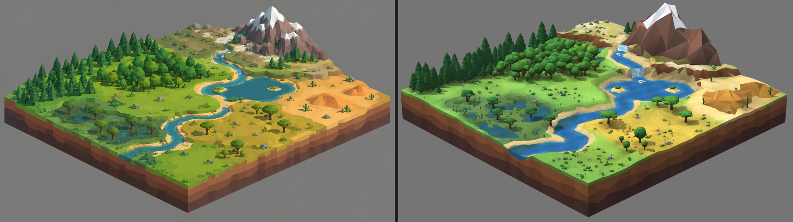

# T1: réplica da folha-mestra no motor da maquete

À esquerda, a referência `estilo/folha-mestra.png`. À direita, a mesma cena no motor, capturada numa janela de navegador de 1920×1080. A página é `prototipo/replica.html`. As posições foram lidas da folha, em pixels, e levadas ao chão por uma transformação de perspectiva. A câmera foi ajustada para os cantos baterem.

As cores vêm do globo do M2 (decisão 2 de 2026-11-06), por isso os verdes e amarelos são mais claros que os da folha. Isso é esperado e não é erro da réplica.

| Ponto | Como foi feito | O que ainda difere da referência |
|---|---|---|
| a) Luz suave e oclusão | Luz do céu mais sol, sombra macia em 6 amostras e tingida de azul, nada de preto. Chão escurece no pé do relevo e em volta das plantas; base de copas e troncos escurece no próprio modelo. | A oclusão é mais fraca que a da folha entre as árvores. |
| b) Tom dentro do bioma, passagem gradual | Duas manchas de tom sobre a cor do globo e deriva entre quente e frio. Limite de bioma ondulado por ruído, com a cor misturada em ~3 células. | Os tons da folha têm mais amarelo e oliva, por causa da decisão 2. |
| c) Árvores certas e agrupadas | Pinheiro de 4–5 saias na taiga, carvalho em tufos e árvore redonda na floresta, copa em placas na savana e no pântano. Modelos variados, tamanhos diferentes, mata mais fechada no miolo e rala na borda. | A mata de pinheiros da folha é um pouco mais cheia. |
| d) Tufos, arbustos e pedras | Manchas de arbustos em bolinhas, capim e pedras facetadas, com vazios entre as manchas; juncos e arbustos no pântano; arbusto seco e pedra no deserto. | Na folha há mais tufos miúdos. |
| e) Rio, cachoeira, lago e costa | O rio é um canal cavado no chão. A linha da água é o encontro do chão com o nível. Um degrau no nível da água vira queda, com espuma no pé. Areia com contorno nítido. Lago com duas ilhas. | A queda é mais larga e mais plana que a da folha. |
| f) Borda em camadas e montanhas facetadas | Lábio de grama e três faixas de terra em degraus irregulares. A montanha é uma rede de triângulos grandes por cima do chão; cada pico tem chapéu de neve por faceta. | A montanha da folha tem mais facetas pequenas e rochas no pé. |
