# M3: decisões provisórias para o usuário revisar

Todas foram decididas pelo Claude Code durante o bloco "fechar o M3" (regra de 2026-11-09), na ordem de critério combinada: (a) o mais perto das referências; (b) o que já estava em `docs/`; (c) o mundo real; (d) o mais simples de desfazer. **Nenhuma é definitiva.** Para cada uma: o que ficou, a alternativa principal e o motivo. Capturas no Firefox, em janela de 1920×1080.

Onde não há imagem da alternativa, é porque ela não foi construída: está dito na linha.

## 1. Escolhas que o usuário já tinha feito na mensagem (aplicadas)
| # | Decisão | O que ficou | Alternativa principal | Imagem |
|---:|---|---|---|---|
| 1 | Ritmo do tempo | Opção 5: na maquete, em 1×, um mês por segundo; o selo mostra "1× · 1 mês/s". 2×, 5×, 20× e Máx não mudam | Opção 6, deixar como estava (a floresta queimava e voltava enquanto o animal dava 5 passos) | Ficou: `rev-ritmo.jpg`. Alternativa: sem imagem (é ritmo, não aparece numa captura) |
| 2 | Petróleo aparente | Opção 2: cava única e grande, com o chão aplainado em volta | Opção 1, cavas médias (saíam fundidas, com uma borda por cima da outra) | Ficou: `fid-p3-jazidas.jpg`. As duas: `dec-oleo.png` |
| 3 | Suavização | FXAA | MSAA 4× (estourava a meta de 8 ms de GPU) | As duas: `dec-suavizacao.png` |
| 4 | Lista de espécies | Opção 1: cartão "Vida" em grade, com ícones no globo | Opção 2, lista lateral por bioma | Ficou: `rev-vida-cartao.jpg` e `rev-vida-globo.jpg`. Opções: `dec-especies.png` |

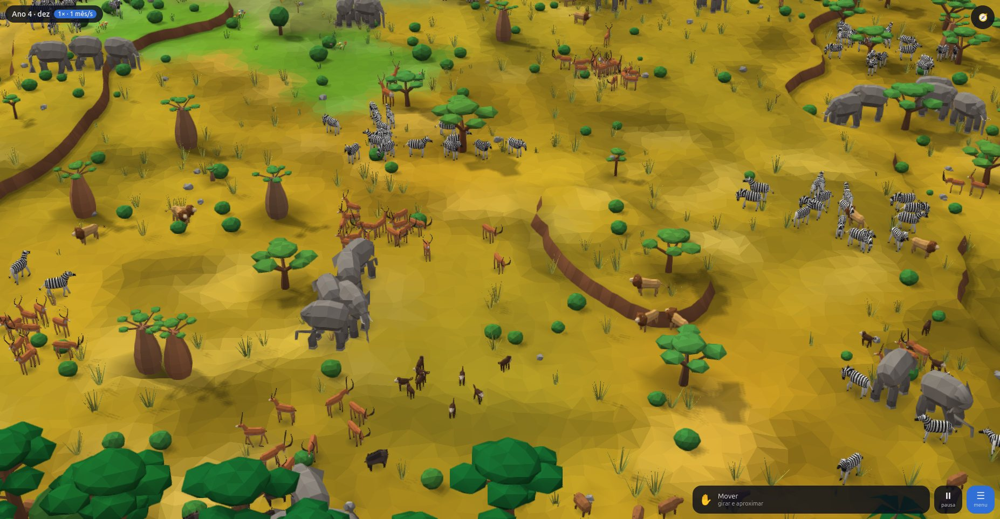
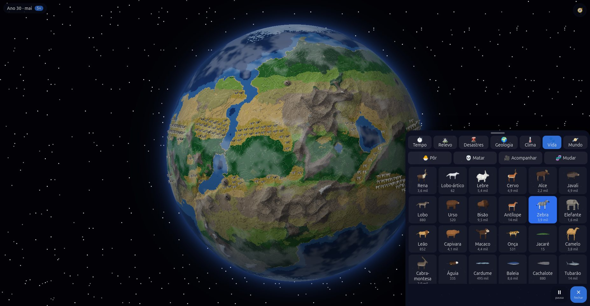
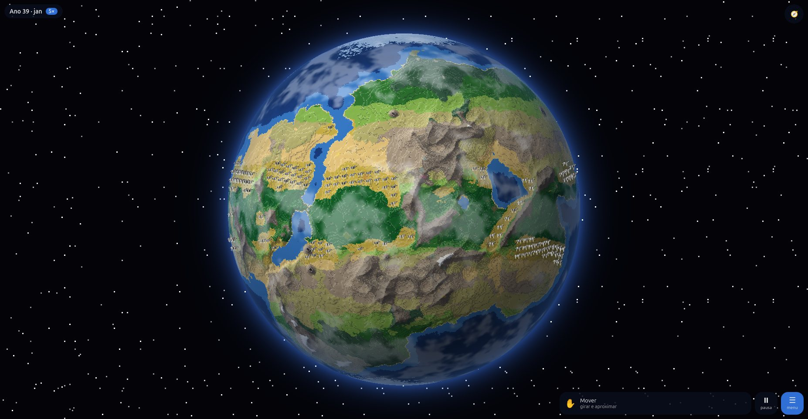
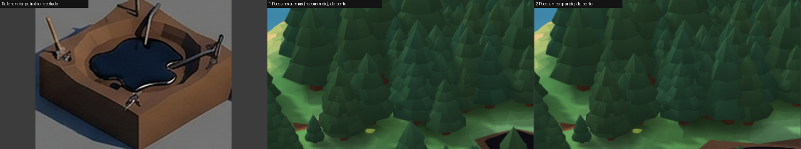
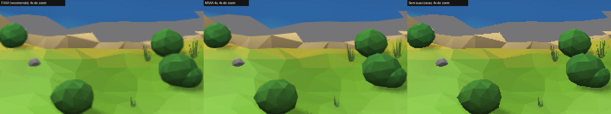
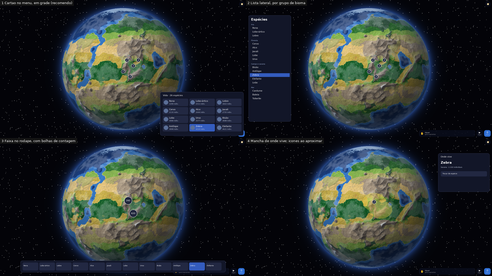

## 2. Visual da maquete (Parte 1)
As imagens de cada item estão em `docs/M3-fidelidade.md`, ao lado da referência.

| # | Decisão | O que ficou | Alternativa principal | Por quê |
|---:|---|---|---|---|
| 5 | Cor da montanha | Patamar verde-grama e parede marrom-rocha, como em `bioma/montanhas-vulcao.png` | Patamar na cor do globo (cinza-marrom), sem salto de cor no corte. Sem imagem | A referência manda (critério a). Efeito: no corte a montanha fica mais verde que no globo |
| 6 | Linha da neve | A neve começa num patamar inteiro; cume solto, em ponta | Neve por altura em cada ponto (a borda saía serrilhada; aparece nas capturas antigas de `dec-relevo.png`) | Fica igual à "Montanha alta" da folha |
| 7 | Degraus do deserto | Um degrau a cada 2 níveis (1,7 de altura), áreas planas maiores | Degrau comum. Sem imagem | "Desertos com grandes áreas planas" (decisão de 2026-11-05) |
| 8 | Jazidas | Afloramento com as cores da folha, 2 lajes por célula, mancha forte no chão; cristais no urânio, no enxofre e nas terras raras, cubos no sal e no lítio | Os montes de pedra redonda da folha (`recursos/jazidas.png`) | O usuário trocou os montes pelo afloramento em 2026-11-06; os montes voltam quando minerar (M4) |
| 9 | Dunas | Cor de areia | Laranja (como estavam). Aparece em `dec-relevo.png` | Laranja é do "planeta em calor extremo" da folha, não do deserto comum |
| 10 | Animais do mar | Inteiros acima da linha da água, azulados na parte de baixo | Água transparente, com o bicho dentro dela, como na folha. Sem imagem | A água da maquete é opaca; transparente mexe em toda a água e custa GPU a medir |
| 11 | Águia | Parada, ela é desenhada voando | Pousada. Sem imagem | No jogo ela só aparece no ar; a pose pousada fica para quando comer no chão |

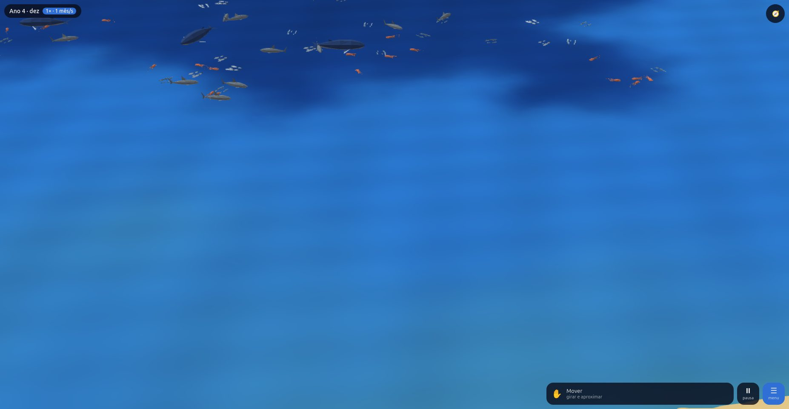

## 3. Ecologia (Parte 2)
| # | Decisão | O que ficou | Alternativa principal | Por quê |
|---:|---|---|---|---|
| 12 | Onde ficam os números | População por **bloco de 8×8 células** (um pedaço da maquete); a especificação dizia "por célula" | Por célula (64 vezes o custo; meio lobo por célula não quer dizer nada) | Custo e sentido. O que se vê de perto é o número do bloco |
| 13 | De quanto em quanto tempo | Cada bloco tem a vez dele de 4 em 4 anos de jogo e nela anda os 4 anos | De ano em ano (medido: 1,1 ms por passo, e o Máx caía de ~1.080 para 275 passos por segundo) | Meta de desempenho; o mundo é o mesmo em qualquer velocidade |
| 14 | Plantas | A biomassa do bloco cresce de forma logística até a capacidade; a vegetação por célula e a cor do globo continuam as do M2 | O pasto baixar a cobertura de cada célula (mudaria o globo aprovado) | Não mexer no que foi aprovado no M2 |
| 15 | Caça | Saturação, refúgio de 10% da presa e caçadores da mesma espécie se atrapalhando | Sem a interferência (medido: tubarão extinguia lula, lula-gigante e cachalote em 100 anos) | "Raramente zeram" (`04-ecologia.md`) |
| 16 | Anos bons e ruins | Chuva regional muda a cada ano, com ciclos de ~6 anos (região) e ~11 anos (planeta) | Sem variação (as populações ficavam paradas, variação de 1%) | "Sobem e descem em ciclos" |
| 17 | Critérios do aceite de 1.000 anos | (a) em nenhuma janela de 100 anos somem 20% ou mais das espécies; (b) toda espécie varia ≥ 1%; (c) ≥ 3 pares em que o caçador varia ≥ 5% e segue a presa com atraso; (d) mesma semente, mesmo resultado. 5 sementes, todas passam | Limiares mais duros (ex.: variação ≥ 5% para toda espécie) | A proposta da especificação, escrita antes de medir |
| 18 | Desastres | Fogo mata 35% e espanta 50% dos bichos da célula; lava e cratera matam todos; enchente e tsunami 50 a 70%; fenda 60%; seca tira 30% da capacidade | Outros números. Sem imagem | `04-ecologia.md`; números a ajustar jogando |
| 19 | Indivíduos da maquete | O pedaço confere os números a cada ~1,4 s e muda um indivíduo por espécie de cada vez; teto de 18 de terra e 5 do mar por espécie e pedaço | Mudar todos de uma vez (ninguém veria a morte) | Dar tempo de ver |
| 20 | Sangue | Mancha vermelho-escura, menor que o corpo, só em quem foi caçado; abre em 3 s e some com o corpo (26 s); sem pedaços | Mancha em toda morte; mancha que dura mais que o corpo. Sem imagem | "Leve, de diorama, sem exagero" |
| 21 | Como usar os poderes | Escolhe a espécie na grade; **Pôr** e **Acompanhar** por toque, **Matar** no raio do pincel, **Mudar** por deslizantes | Tocar primeiro no animal e abrir um cartão dele. Sem imagem | O jeito que o jogo já usa (tocar e pincel) |
| 22 | Características | Tamanho, fome, agressividade, velocidade e fertilidade, de 50% a 200%, valendo para a **espécie inteira** e para os filhotes | Por indivíduo (pediria simular cada um) | O modelo é "de longe números" |
| 23 | Acompanhar com a câmera | Não trava zoom nem velocidade; arrastar solta | Travar a câmera no animal | O jogo nunca muda as escolhas do jogador sozinho (decisão de 2026-10-19) |
| 24 | Classe mítica | Só deus põe. Andam para onde há mais caça, comem muito, não se reproduzem, não envelhecem; morrem pelo poder de deus ou em desastre que arrasa a célula. O dragão põe fogo onde caça (em um quarto dos anos em que comeu) | Reprodução quando deus põe dois; território fixo | O mais simples e o mais fácil de desfazer; "nenhuma nasce sozinha" |
| 25 | Floresta e chuva | Umidade regional dentro da ecologia: o crescimento das plantas do bloco vai de 85% a 115% conforme a vegetação em volta | Somar a floresta à chuva do modelo de clima (mudaria biomas e o globo aprovado) | Não mexer no clima do M2 |
| 26 | Ícones | O próprio modelo visto de lado, pintado em 2D | Imagens desenhadas à parte | Uma fonte só: se o modelo muda, o ícone muda |

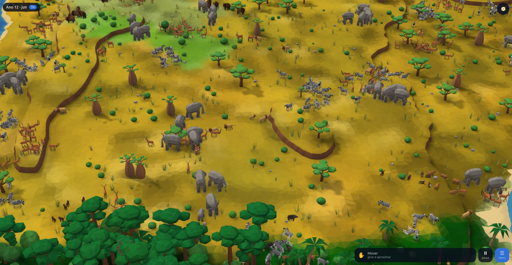
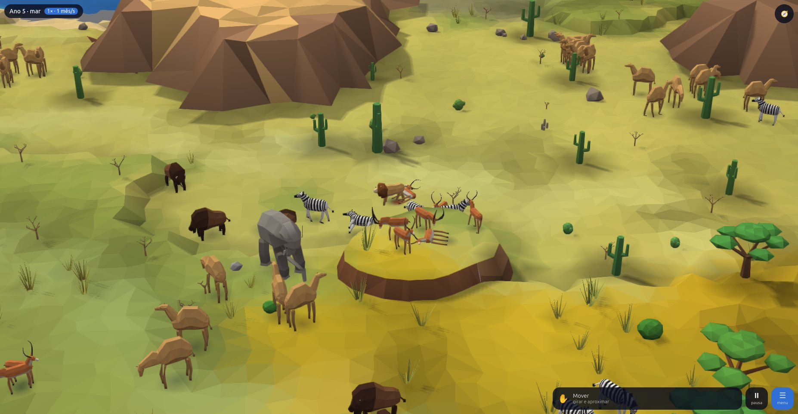
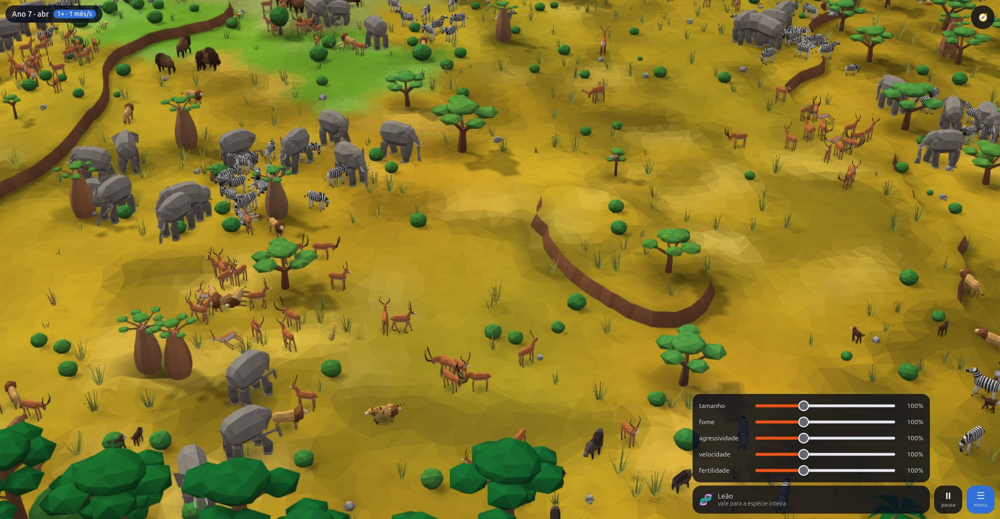
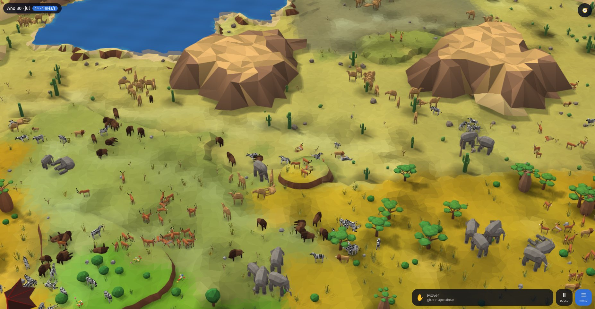

## 4. O que não foi feito, e por quê
- **Domesticação e uso dos animais pelos humanos:** só os campos `domesticável` e `temperamento` na tabela (`src/world/species.ts`). O resto é do M4.
- **Kraken e baleia branca atacando barcos:** não há barcos (M5 a M7). Eles comem os grandes do mar.
- **Pose "comendo" e "andando" separadas, como nas folhas:** são movimento no desenho (pescoço desce, pernas balançam), não modelos à parte.
- **Sucessão das plantas ligada à biomassa da ecologia** (capim antes das árvores): a maquete continua usando a cobertura do M2, que já traz mudas onde a vegetação volta.
- **Água transparente, cristas de duna, degraus na base do vulcão, gelo alto e quebrado:** anotados em `docs/M3-fidelidade.md`, para o acabamento.
